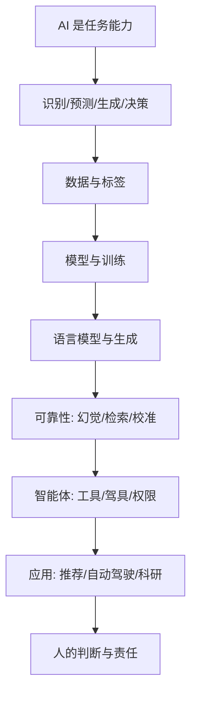

# 《Hello, AI · 人工智能导论》知枢学习系统

## 这本书在讲什么

这本书想回答一个问题：一个没学过 AI 的人，怎样在不被术语和宣传带偏的前提下，理解 AI 能做什么、怎么做、哪里会坏、人该站在哪里。

它的主张很明确：AI 不是一个东西，而是一组任务能力；真正决定成败的，往往不是模型多聪明，而是数据、验证、权限和责任怎么安排。论证主线从日常产品出发，逐层拆到神经网络与语言模型，再落到可靠性、智能体、科学应用和人的位置。

## 全书心智模型

这张图从左到右是「能力—方法—可靠性—行动—责任」。越往右，技术问题越少，组织和责任问题越多。

## 学习路径（推荐顺序）

| 步骤 | 章节 | 主题 | 前置 | 检查点 |
|---|---|---|---|---|
| 01 | ch01–ch02 | 地图与历史 | 无 | 能用自己的话解释六层关系与两次寒冬 |
| 02 | ch03–ch05 | 搜索、规则、强化、监督 | ch01 | 能区分四种学习范式，解释过拟合与分布偏移 |
| 03 | ch06 | 神经网络 | ch05 | 能画出神经元、解释反向传播在做什么 |
| 04 | ch07–ch08 | token、嵌入、注意力、Transformer | ch06 | 能解释 QKV 与位置编码 |
| 05 | ch09 | 预训练、SFT、对齐 | ch08 | 能区分三种训练阶段的目标 |
| 06 | ch10 | 幻觉、RAG、校准 | ch09 | 能说出幻觉的机制与三种降低办法 |
| 07 | ch11–ch12 | 多模态、工具、智能体 | ch09 | 能拆驾具循环，说出三道安全带 |
| 08 | ch13 | AlphaFold 与 AI 做科学 | ch09 | 能解释监督学习定位与边界 |
| 09 | ch14 | 提示、验证、责任 | ch12 | 能写一份带验证方案的使用计划 |
| 10 | t01–t06 | 六个应用与工程专题 | 各前置章 | 能各用一句话说出该专题的核心取舍 |

## 章节索引

- 第 1 章 你已经在用 AI 了（★☆☆）→ chapters/ch01.md
- 第 2 章 七十年，三次浪潮（★★☆）→ chapters/ch02.md
- 第 3 章 机器怎么「学」：搜索、规则与强化（★★☆）→ chapters/ch03.md
- 第 4 章 从数据里找规律：监督与自监督（★★☆）→ chapters/ch04.md
- 第 5 章 模型为什么会「翻车」（★★☆）→ chapters/ch05.md
- 第 6 章 神经网络：从神经元到深度网络（★★★）→ chapters/ch06.md
- 第 7 章 语言模型的第一课：token 与嵌入（★★☆）→ chapters/ch07.md
- 第 8 章 注意力与 Transformer（★★★）→ chapters/ch08.md
- 第 9 章 大模型是怎样炼成的（★★★）→ chapters/ch09.md
- 第 10 章 幻觉、检索与可靠性（★★★）→ chapters/ch10.md
- 第 11 章 多模态与生成（★★★）→ chapters/ch11.md
- 第 12 章 智能体与工具使用（★★★）→ chapters/ch12.md
- 第 13 章 AI 做科学：AlphaFold 与边界（★★★）→ chapters/ch13.md
- 第 14 章 人的位置：提示、判断与责任（★★☆）→ chapters/ch14.md
- 专题 1 一次回答的推理流水线（★★☆）→ chapters/t01.md
- 专题 2 推荐系统：猜你喜欢什么（★★☆）→ chapters/t02.md
- 专题 3 自动驾驶：AI 在路上（★★★）→ chapters/t03.md
- 专题 4 给科研人的机器学习实用课（★★★）→ chapters/t04.md
- 专题 5 训练一个模型：从数据到对齐的实操（★★★）→ chapters/t05.md
- 专题 6 AI 与开源（★★☆）→ chapters/t06.md

## 前置知识（零基础缺口补讲）

| 缺口 | 对应补讲位置 | 学完标志 |
|---|---|---|
| 不知道「模型」「参数」「训练」是什么 | 第 4 章「监督学习」与第 6 章「神经元」 | 能解释参数是训练调出来的数，不是人写的规则 |
| 没学过导数、看不懂梯度 | 概念页「梯度下降」的深度推导 §1–§2 | 能说出梯度方向与更新公式 |
| 不知道概率、softmax | 概念页「自注意力与 QKV」深度推导 §1 | 能解释为什么权重加起来为 1 |
| 没接触过神经网络 | 第 6 章零基础讲解 + 概念页「表示学习与反向传播」 | 能画出输入—权重—激活—输出的流程 |
| 不知道什么是 token | 第 7 章「分词与 BPE」 | 能解释为什么模型数不清字母 |
| 没写过提示词 | 第 14 章「提示词」+ 速查表 | 能写出任务、对象、标准、格式四要素 |
| 不理解「对齐」 | 第 9 章「预训练、SFT 与对齐」 | 能区分预训练、SFT、偏好对齐三阶段 |

## 术语表 / 模式库 / 速查表 入口

- 术语表：`glossary.md`，110 条，按原书章节顺序。
- 模式库：`patterns.md`，八个可迁移框架、决策规则与反模式。
- 速查表：`cheatsheet.md`，公式、概念对照、判断流程与成本量级。
- 测验：`quiz.md`，每章 5 道自测 + 60 道综合单选 + 最终检验。
- 抽认卡：`flashcards.md`，50 张概念卡 + 20 张章节锚点卡。
- 单书学习伴侣：`hello-ai学习伴侣.html`；总入口：`../index.html`。

## 怎么用这套系统

1. 先打开 `../index.html`，在顶部选择这本书。
2. 按「学习路径」推进，每章读完做自测；答错时看解析，再回到概念页。
3. 高难概念页底部有「🔬 展开完整第一性原理推导」，卡住时展开。
4. 用「🩺 诊断测试」随机抽题，答错会沿前置链倒推根因。
5. 用抽认卡做间隔复习：次日、3 天、7 天各一次。
6. 最后做 `quiz.md` 的最终检验，产出一份可执行的使用方案。

## 阅读约定

- 每一章先看「一句话核心」，再看讲解；不要从细节开始。
- 术语第一次出现会给白话定义，不必背；用到时回术语表。
- 图示看结构，类比看直觉，实例看可验证的数字；三者不能互相替代。
- 书里的例子经过转译，数值算例可自己复核；发现算不通，以你的计算为准并记录。
