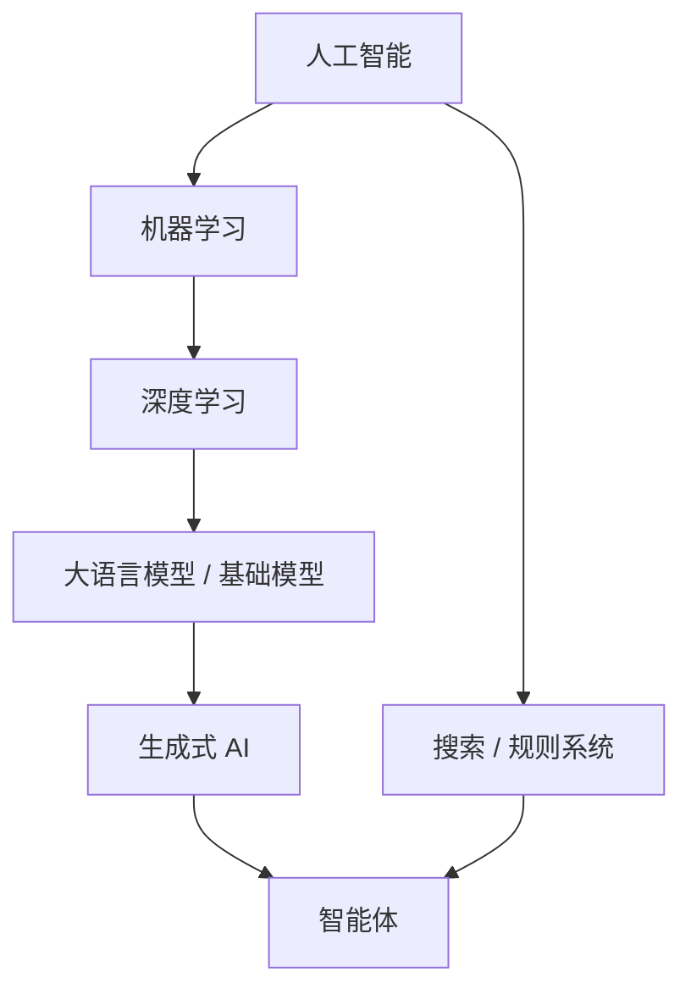

# 第 1 章：你已经在用 AI 了

> 第一部 · 地图　·　一个诚实的定义，一张不会过时的地图，以及为什么「AI」这个词总在往后退。

- **难度**：★☆☆ ｜ **预估学时**：1–2 小时 ｜ **前置**：无

## 学习目标

学完本章，你能：

- 能用一句话说清什么算 AI、什么只是自动化。
- 能把一个 AI 产品拆成识别、预测、生成、决策四种能力。
- 能分清 AI、机器学习、深度学习、大模型、生成式 AI、智能体六层关系。

## 一句话核心

AI 是让机器完成那些通常需要人类智能才能完成的任务；判断一个产品，先问它在做哪种任务，再问它靠什么做到、在哪里会出错。

## 零基础讲解

### 概念 1：定义看任务，不看方法

「人工智能」这个词是 1956 年夏天在达特茅斯学院的一场研讨会上定下来的。提出它的约翰·麦卡锡给了一个很宽松的说法：让机器去做那些「如果由人来做，我们会说需要智能」的事。

这个定义的重点在**任务**，不在实现方式。下棋、翻译、认脸、写一段话，过去只有人能做得像样，所以机器做到这些就算 AI。它不要求机器有意识，也不要求它像人一样思考。1997 年靠搜索击败国际象棋冠军的深蓝，和今天会聊天的大模型，技术路线完全不同，但都落在这个定义里。

这也解释了一个反复出现的现象：**AI 效应**。计算器算得比人快，没人说它是 AI；语音输入、路线规划刚出现时都是 AI 明星课题，普及之后就成了「普通软件」。一旦机器把某件事做成了常规，我们就不再觉得那件事需要智能。AI 这个词的边界，永远指向机器还做不太好的那一片。

### 概念 2：六层包含关系

新闻里常混着六个词：AI、机器学习、深度学习、大模型、生成式 AI、智能体。它们不是并列关系，而是一层套一层。

- **人工智能**：最大的伞，所有让机器做「聪明事」的办法都算，包括人写规则、搜索、统计学习。
- **机器学习**：一种特定做法，不由人写规则，而是给大量例子让机器自己找规律。
- **深度学习**：机器学习里用多层神经网络的分支，连「该看数据的哪些方面」也交给机器学习。
- **大语言模型**：在海量文本上训练、以预测下一个 token 为目标的超大网络，是深度学习的一种极端形态。
- **生成式 AI**：强调用途，能造出原本不存在的文字、图像、音频、视频或代码。
- **智能体**：把模型放进一个循环，给它目标和工具，让它自己决定下一步，直到完成任务。

越往里越新、越具体，也越接近你每天用的产品；外面的圈没有消失。用大模型去解决一个查表就能解决的问题，等于用推土机撬罐头。

### 概念 3：四种能力

按「它在做什么」来分，几乎所有 AI 应用都能归入四种能力，或者它们的组合。

- **识别**：输入一个东西，判断它是什么。人脸解锁、相册搜猫、语音转文字、垃圾邮件过滤。
- **预测**：根据过去估计未来或未知。地图预计到达时间、电商猜你会买什么、医院预测再入院风险。
- **生成**：造出原本不存在的内容。写文字、画图、合成语音、生成代码。
- **决策**：在环境里选择行动。下棋、机器人移动、自动驾驶转向、智能体调用工具。

四者的难度和风险不一样。识别最成熟，很多任务准确率已超过人；预测完全依赖历史数据是否包含未来的规律；生成最抢眼，也最容易「像而不对」；决策有后果，后果会改变环境，环境又影响下一步。

一个真实产品往往把它们串起来。你对着手机说「帮我订明天去北京的高铁」：语音识别把声音变成文字，语言模型理解意图并规划步骤，查询系统预测哪趟车更可能有票，最后生成一段确认信息。拆开之后，你立刻知道它的强项在哪、哪一环最可能出错。

## 图示

这张图看两件事：越往下越新、越接近日常产品；左边的搜索和规则系统并没有消失，它们会和模型一起进入智能体。

## 类比与实例

- **类比**：AI 像一把不断生长的伞。每当下雨的范围扩大，伞面就跟着扩；已经干了的区域会被移出伞下，改叫「普通软件」。伞的边界不是技术定义，而是人们还觉不觉得这件事难。
- **实例**：早上 6:50 人脸解锁（识别），7:30 地图预测 25 分钟到达（预测），10:30 让助手把会议记录整理成要点（生成），18:30 网约车报价（预测）。一天里真正「纯生成」的环节很少，多数是识别或预测加规则执行。

## 常见误解

- 别以为 AI 就是大模型——实际上 大模型只是当前最耀眼的一层。导航里的 A*、银行的反欺诈规则、相机的自动对焦，很多都不是大模型，仍然属于 AI。
- 别以为 AI 什么都能做——实际上 AI 擅长例子多、答案相对明确、错了代价可检查的任务；例子稀少、没有共识、需要承担责任的判断，它做不了。
- 别以为 机器算得快就是智能——实际上 算得快只是速度。AI 效应说明，一旦某件事变成常规计算，人们就不再把它算作智能。

## 自测题（答案）

1. 一个软件能在 0.1 秒内算出 20 位数的乘法。按本章定义，它是 AI 吗？（答案：不是严格意义上的 AI。它做的是固定的算术流程，不需要通常由人承担的判断；这也是计算器不被当作 AI 的原因。；解析：定义看的是任务是否需要人类智能，不是算得快不快。）
2. 「大模型就是 AI」这句话错在哪？（答案：大模型是 AI 的一个子集，属于深度学习里的语言模型。AI 还包括搜索、规则系统、强化学习等大量非大模型方法。；解析：六层包含关系里，大模型在里层，AI 在最外层。）
3. 手机相册里搜索「猫」，属于四种能力里的哪一种？（答案：主要是识别：判断图像内容是不是猫。排序和检索还会用到预测，但核心是识别。；解析：识别是输入一个东西、判断它是什么。）
4. 为什么说 AI 不承担责任是社会选择，不是技术限制？（答案：模型可以给出诊断建议或判决理由，但签字、宣判、承担后果仍然由人来做。社会把责任留给了人，而不是模型做不到。；解析：技术能生成建议，但不能替人承担后果。）
5. AI 效应是什么？（答案：机器一旦把某件事做成常规，人们就不再把这件事业算作智能。；解析：它解释了 AI 的边界为什么总在往后退。）

## 复习锚点

- AI 的定义看任务，不看方法。
- 六层包含关系：AI ⊃ 机器学习 ⊃ 深度学习 ⊃ 大模型；生成式 AI 和智能体是另外两个切面。
- 看到产品先拆四种能力：识别、预测、生成、决策。
