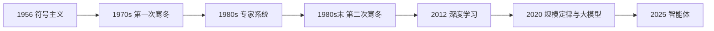

# 第 2 章：七十年，三次浪潮

> 第一部 · 地图　·　AI 的历史不是一条上升的直线，而是几次高潮与几次寒冬。每次转折都有一个具体的原因。

- **难度**：★★☆ ｜ **预估学时**：2 小时 ｜ **前置**：第 1 章

## 学习目标

学完本章，你能：

- 能按时间顺序说出符号主义、专家系统、深度学习三次浪潮。
- 能解释两次 AI 寒冬的共同原因：承诺与能力之间的落差。
- 能说清算力、数据、算法在 2012 年突破里各自起了什么作用。

## 一句话核心

每一次浪潮都由一个真正的想法点燃，每一次退潮都因为撞上同一堵墙：承诺超过了当时的数据与算力能兑现的程度。

## 零基础讲解

### 概念 1：三次浪潮与两次寒冬

**第一次浪潮（1956–1970 年代）**是符号主义。研究者相信智能就是对符号的操作：把知识写成概念、命题和逻辑规则，机器按规则推演就能推理。代表成果是定理证明、早期自然语言理解和通用问题求解器。它撞上的墙叫**知识获取瓶颈**：世界上的知识太多、太模糊，靠人一条条写进去写不完，规则之间还会打架。

**第二次浪潮（1980 年代）**是专家系统。把某个狭窄领域里专家的经验写成几百到几千条 if-then 规则，再配一个推理引擎，让机器当顾问。它在医疗、地质勘探、配置电脑等场景里卖得很好，商业上第一次成了产业。但它仍然要人写规则，维护成本高、遇到新情况就失灵，最后退潮。

**第三次浪潮（2012 年至今）**是深度学习。它不再由人写规则，而是让多层神经网络从数据里学。2012 年的 ImageNet 竞赛，深度卷积网络把图像识别错误率从 26% 降到 16%，标志着这轮浪潮的起点。2020 年前后，规模定律和大模型把它推到语言、代码、科学等几乎所有领域。

两次寒冬（1970 年代中期、1980 年代末）的共同点不是技术「失败」，而是**承诺与能力之间的落差**。研究者在上一轮高潮里承诺了通用智能，演示却只能在玩具问题上跑；经费和信心一旦撤出，整个领域就进入低潮。

### 概念 2：2012 年为什么突然成了

深度学习的想法并不新。1958 年的感知机就会从例子里学简单的线性分类；反向传播在 1980 年代已经流行。它沉寂几十年，是因为三个条件同时不到位。

- **数据**：ImageNet 从 2007 年起收集了一千四百万张人工标注的图片。没有这么多带标签的猫，网络再深也学不出猫。
- **算力**：GPU 原本为游戏渲染设计，恰好擅长并行矩阵运算。2012 年的突破是在两块游戏显卡上跑出来的；今天前沿模型用几万块 GPU。
- **算法**：多层结构、反向传播、卷积、激活函数这些零件早就有了，ReLU、Dropout 等技巧让深网络真正可训练。

三者缺一不可。只讲「神经网络赢了」会漏掉最关键的一点：同一套算法，在数据和算力不够的年代，连跑都跑不起来。

### 概念 3：规模定律

2020 年前后，研究者总结出一条经验规律：在一定范围内，模型的损失随参数量、数据量、计算量的增加，呈可预测的幂律下降。这就是**规模定律**。

它把「把模型做大」从赌博变成了工程。只要按比例增加参数、数据和算力，性能大概会按已知的曲线改善，行业因此敢押注超大模型。它也是大模型军备竞赛的直接理由。

但规模定律不是万能。它描述的是「一定范围内」的趋势，会遇到数据用尽、收益递减、能耗和成本上升等边界；它也无法保证模型在需要精确事实或承担责任的任务上变可靠。规模能买来能力，买不来真实性。

## 图示

这张图看节奏：三座山、两个谷。每个谷都不是「技术没用」，而是承诺跑在了能力前面。

## 类比与实例

- **类比**：像修一条越走越高的山路。每次有人看到山顶就宣布「快到了」，但走到跟前发现前面还有一道崖；掉下去一次，队伍要花很多年才爬回原来的高度。
- **实例**：2012 年 ImageNet：同一类卷积网络，在 CPU 和小数据上只能得到普通结果；两块 GPU 加一千四百万张标注图片，错误率从 26% 降到 16%。变的是条件，不只是想法。

## 常见误解

- 别以为 AI 是一直匀速进步的——实际上 它是浪潮式推进：想法先出现，等数据和算力到位才兑现，兑现不了就退潮。
- 别以为 寒冬说明方向错了——实际上 寒冬说明承诺超过了当时能兑现的能力，不等于技术没有价值。很多寒冬里的工作后来成了基础。
- 别以为 2012 年赢在算法更聪明——实际上 算法重要，但数据与算力同样关键。三者是三角形，缺一角都跑不起来。

## 自测题（答案）

1. 两次 AI 寒冬的共同原因是什么？（答案：承诺与能力之间的落差：演示只在玩具问题上成立，却被说成通用智能，经费和信心随后撤出。；解析：不是技术完全失败，而是兑现不了承诺。）
2. 符号主义最大的瓶颈是什么？（答案：知识获取瓶颈：世界知识太多、太模糊，靠人写规则写不完，规则之间还会冲突。；解析：专家系统也继承了这个问题。）
3. 2012 年深度学习的突破依赖哪三个条件？（答案：数据（ImageNet 等大规模标注集）、算力（GPU 并行计算）、算法（多层网络与反向传播等）。；解析：三者缺一不可，不能只归功于算法。）
4. 规模定律说了什么？（答案：在一定范围内，模型损失随参数量、数据量、计算量增加而按幂律可预测地下降。；解析：它让扩大模型从赌博变成工程，但有边界。）
5. 为什么说「AI 寒冬」对今天仍有提醒意义？（答案：它提醒我们把「能做什么」和「被说成能做什么」分开，别用演示效果代替真实能力。；解析：今天的模型也会被营销话术夸大。）

## 复习锚点

- 三次浪潮：符号主义、专家系统、深度学习。
- 两次寒冬的共同原因是承诺超过能力。
- 2012 年突破 = 数据 + 算力 + 算法。
