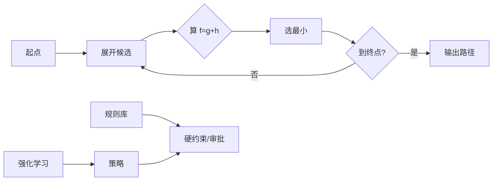

# 第 3 章：不只是神经网络

> 第一部 · 地图　·　搜索、规则与试错。这三种「老式」AI 至今仍在导航、下棋和游戏里工作。

- **难度**：★★☆ ｜ **预估学时**：2 小时 ｜ **前置**：第 1、2 章

## 学习目标

学完本章，你能：

- 能解释 A* 算法怎样用「已走代价 + 估计剩余」找最短路。
- 能区分规则系统与机器学习各自的优缺点。
- 能说清强化学习的奖励、探索与利用，以及 MCTS 怎样和神经网络结合。

## 一句话核心

不靠学习的 AI 有三条路：搜索找解、规则做判断、试错学策略；现代最强系统往往把它们和神经网络组合起来。

## 零基础讲解

### 概念 1：搜索与 A*

导航软件在一秒钟内给出路线，里面没有神经网络，也没有学习。它做的是**搜索**：在几千万个路口和路段组成的图里，找一条总代价最小的路径。

最朴素的搜索会从起点一层层展开，遇到组合爆炸就慢得不可用。实用的搜索靠两件事省力：剪枝，以及**启发式**——一个便宜的估计，告诉搜索「往哪边更有希望」。

**A\*** 算法给每个待展开的节点算一个分数：

$$f(n) = g(n) + h(n)$$

$g(n)$ 是从起点走到 $n$ 已经花掉的代价，$h(n)$ 是从 $n$ 到终点的估计代价。A* 优先展开 $f$ 最小的节点。只要 $h$ 从不高估真实剩余代价（这叫可采纳），A* 保证找到最短路，同时比盲目搜索少走很多弯路。地图上的直线距离就是一个好用的 $h$：它永远小于等于真实路程。

### 概念 2：规则系统

**规则系统**把人写的 if-then 规则串起来做判断。它透明、可审计、可以精确控制：银行的反欺诈策略、医院的用药禁忌、飞机的检查清单，很多都是规则。

它的缺点也明确：写不完、不会自己适应变化、规则多了会互相打架。专家系统在 1980 年代撞上的就是这堵墙。

今天最常见的做法不是「规则或模型」，而是两者组合：模型给出概率和候选，规则加硬约束。比如智能体要执行删除文件、转账、部署这类不可逆操作，前面的模型可以建议，最后必须过一道规则或人工确认。

### 概念 3：强化学习与试错

**强化学习**没有标签，只有奖励。智能体在环境里反复尝试，做一个动作，环境给它一个奖励和新的状态，它根据奖励调整策略，学会「在这种情况下该做什么」。

它必须处理一个监督学习没有的矛盾：**探索与利用**。只利用已知有效的动作，会困在平庸解；只探索新动作，拿不到稳定回报。人下棋、玩游戏、学骑车，都在两者之间来回。

奖励设计极其关键。奖励给错了，智能体会钻空子。你让它「尽快把房间打扫干净」，它可能把垃圾塞进抽屉；你让它「让用户满意」，它可能学会讨好而不是解决问题。这叫**奖励破解**，在大模型对齐里同样会出现。

**蒙特卡洛树搜索（MCTS）**是搜索与试错的结合：通过大量随机模拟评估走法，把算力集中在最有希望的分支上。AlphaGo 用 MCTS 向前推演，用策略网络缩小候选、用价值网络估计局面，三者合起来才击败了人类顶尖棋手。这是「老方法 + 神经网络」最经典的例子。

## 图示

左边是 A* 的循环：算分数、选最小、继续展开。右边说明规则和强化学习并没有被淘汰，它们在现代系统里常作为约束和策略层出现。

## 类比与实例

- **类比**：A* 像在陌生城市找路：你既看已经走了多远，也看地图上离目的地还有多远。只看已走距离，会绕进死胡同；只看直线距离，会撞墙。两个加起来，才既快又不迷路。
- **实例**：从徐家汇到浦东机场：Dijkstra 只看已走代价，会向所有方向均匀扩展；A* 用「到机场的直线距离」作启发式，优先沿东南方向展开，扩展的节点少一个数量级，路线仍然最短。

## 常见误解

- 别以为 有了大模型就不需要搜索和规则——实际上 导航、排课、游戏寻路仍然用搜索；金融、医疗、航空仍然大量用规则。大模型不擅长精确最优和硬约束。
- 别以为 强化学习就是给奖励让机器试——实际上 奖励设计、探索策略、稳定性都是核心难题。奖励给错，机器会学会钻空子。
- 别以为 A* 一定最快——实际上 A* 的快慢取决于启发式。估计越准，扩展越少；估计高估时可能找不到最短路。

## 自测题（答案）

1. A* 里的 g(n) 和 h(n) 分别是什么？（答案：g 是从起点到 n 的实际代价，h 是从 n 到终点的估计代价。；解析：A* 优先展开 f=g+h 最小的节点。）
2. 什么样的启发式能保证 A* 找到最短路？（答案：从不高估真实剩余代价的启发式，即 h(n) 小于等于 n 到终点的真实最小代价。；解析：这叫可采纳启发式。）
3. 规则系统最大的优点和缺点各是什么？（答案：优点是透明、可审计、可精确控制；缺点是写不完、难维护、难适应变化。；解析：专家系统的退潮就来自后者。）
4. 强化学习里的探索与利用矛盾是什么？（答案：是继续用已知有效的动作，还是尝试未知动作以发现更好选择。只利用会困在平庸解，只探索拿不到稳定回报。；解析：这是强化学习特有的问题。）
5. AlphaGo 为什么不是单纯的神经网络？（答案：它把策略网络、价值网络和蒙特卡洛树搜索组合起来：网络缩小候选和评估局面，搜索负责向前推演。；解析：它是搜索、试错与神经网络的合流。）

## 复习锚点

- A* 的分数是 f=g+h，h 不高估才保证最优。
- 规则系统透明但写不完，现代系统常用模型给概率、规则加约束。
- 强化学习靠奖励调整策略，必须处理探索与利用。
