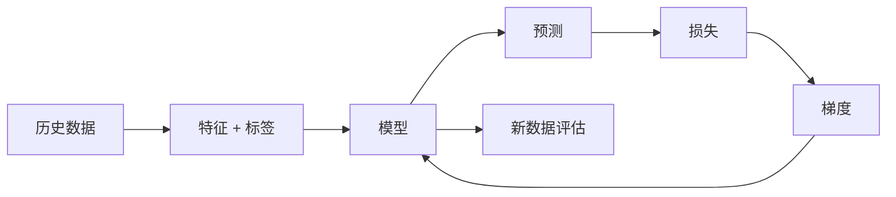

# 第 4 章：规则不是写出来的，是学出来的

> 第二部 · 学习　·　机器学习的全部核心思想，其实只有一句话。这一章用一笔网约车订单把它讲透。

- **难度**：★★☆ ｜ **预估学时**：3 小时 ｜ **前置**：第 1–3 章

## 学习目标

学完本章，你能：

- 能用自己的话解释监督学习：从带标签的样本里学一个映射。
- 能说清模型、参数、损失函数、梯度下降各自在做什么。
- 能判断一个任务该用监督、无监督还是自监督学习。

## 一句话核心

机器学习不是写规则，而是给大量「输入—答案」的例子，让模型自己调参数，使预测的误差变小。

## 零基础讲解

### 概念 1：从规则到样本

传统编程是「人写规则，程序按规则算答案」。机器学习反过来：给人一堆「输入 + 正确答案」的例子，让机器自己找规则。这个「答案」叫**标签**，一条例子叫**样本**，描述样本的各个数值叫**特征**。

网约车报价是个好例子。三十年前，价格由一张收费表决定：起步价、每公里、夜间加成，全是人写的。今天的平台把过去几亿笔订单的距离、时段、天气、供需和最终成交价喂给模型，让模型自己找「什么样的行程值多少钱」。没有人写「雨天晚高峰加价 23%」，但模型的行为里包含了它，而且更细。

### 概念 2：模型就是一台带旋钮的机器

模型可以想成一台机器：输入特征，输出预测。机器里有一组**参数**，也就是旋钮。学习就是找到一组让预测尽量准的旋钮位置。

最简单的模型是一条直线：

$$\hat y = w_1x_1 + w_2x_2 + \cdots + w_nx_n + b$$

$x_i$ 是特征，$w_i$ 是权重，$b$ 是偏置。房价预测里，$w_1$ 可以理解成「每多一平米加多少钱」；网约车报价里，某个 $w$ 可能对应「每多一公里加多少钱」。大模型有几千亿个这样的旋钮，但道理一样：它们都是训练出来的数，不是人规定的。

### 概念 3：损失函数与梯度下降

模型错了多少，要变成一个可计算的数，叫**损失函数**。回归任务常用平方误差：

$$L = \frac{1}{n}\sum_{i=1}^{n}(\hat y_i - y_i)^2$$

$\hat y_i$ 是预测，$y_i$ 是真实值。损失越小，模型在当前数据上越准。

训练就是不断调参数让损失下降。最常用的方法是**梯度下降**：对每个参数算一个梯度，告诉你「把这个旋钮往哪边拧、损失会变大还是变小」，然后沿变小的方向走一小步。

$$w \leftarrow w - \eta \nabla L(w)$$

$\eta$ 是学习率，决定步子多大。步子太小，训练慢；步子太大，可能跨过谷底，损失反而上升。把梯度的直觉想成蒙眼下山：你摸到脚下哪边更低，就往那边迈一步，反复走，最后到谷底。

### 概念 4：三种学习方式

- **监督学习**：数据带标签，学从特征到标签的映射。识别和预测主要靠它，瓶颈是标签昂贵。
- **无监督学习**：没有标签，只找结构：聚类、异常检测、降维。它告诉你数据里有分野，不告诉你每群叫什么。
- **自监督学习**：从数据自身造标签。遮住一个词让模型猜、截断一段文字让模型续写。不需要人工标注，所以能用整个互联网训练。这是大语言模型能出现的直接原因。

一个完整项目不只是「选个模型」。通常要走七步：定义任务、收集数据、构造特征、划分数据、训练、评估、部署与监控。其中「用什么模型」往往是最不重要的决定。

## 图示

这张图看训练闭环：数据进模型，预测和真实答案算损失，梯度把参数往回拧，循环很多次。右边的新数据评估才是真正的考试。

## 类比与实例

- **类比**：调参数像调一台老式收音机的旋钮。你先听声音清不清楚（损失），再判断该往左还是往右拧（梯度），每次拧一点（学习率），反复几次就调到最清楚的频道。
- **实例**：用一条直线预测房价：面积 60 平米、真实成交 300 万，模型当前预测 280 万，误差 20 万；损失对权重的梯度为正，说明增大权重会让损失更大，于是把权重往小的方向调一点。重复几千次，直线逐渐贴近数据。

## 常见误解

- 别以为 机器学习就是让机器自己发明规则——实际上 它学的是数据里的统计规律，不是人那样的因果理解。规律以参数形式存在，人读不懂但可以测试。
- 别以为 参数越多一定越好——实际上 参数多能表达更复杂的规律，也更容易过拟合、更贵。关键是在新数据上表现好。
- 别以为 训练就是背答案——实际上 训练数据上的好成绩不算数。真正的目标是泛化，第五章会讲。
- 别以为 无监督学习不需要数据——实际上 它需要大量数据，只是不需要人打标签。

## 自测题（答案）

1. 监督学习和无监督学习的核心区别是什么？（答案：监督学习的数据带标签，学从特征到标签的映射；无监督学习没有标签，只找数据里的结构。；解析：区别在有没有「正确答案」。）
2. 模型参数和超参数有什么区别？（答案：参数由训练决定，如权重和偏置；超参数由人在训练前设定，如学习率、层数、训练轮数。；解析：日常说「调参」多指调超参数。）
3. 梯度下降里的学习率太大或太小会怎样？（答案：太小学得慢；太大可能跨过谷底，损失震荡甚至发散。；解析：学习率决定每一步走多远。）
4. 自监督学习为什么能利用整个互联网？（答案：标签从数据自身产生，比如遮词猜词、续写下一段，不需要人工标注。；解析：这绕开了标注瓶颈，是大模型出现的关键。）
5. 为什么说「用什么模型」往往不是最重要的决定？（答案：任务定义、数据质量、特征、评估和监控通常更决定成败；模型只是其中一环。；解析：一个完整项目有七步，模型选择只是其中之一。）

## 复习锚点

- 机器学习 = 从带标签样本里学映射，而不是人写规则。
- 模型是带旋钮的机器，参数由训练决定。
- 梯度下降沿损失下降方向小步调整参数。
