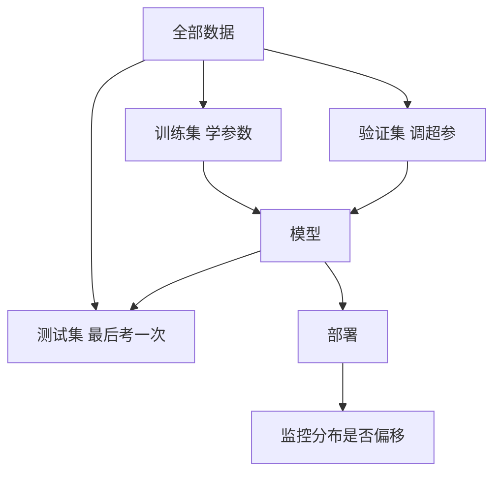

# 第 5 章：真正的考试在训练集之外

> 第二部 · 学习　·　一个模型在见过的数据上表现好，不说明任何事。这一章讲泛化、过拟合、评估和数据陷阱。

- **难度**：★★☆ ｜ **预估学时**：3 小时 ｜ **前置**：第 4 章

## 学习目标

学完本章，你能：

- 能解释泛化、过拟合、欠拟合，以及训练集/验证集/测试集为什么要分开。
- 能在类别不平衡时正确使用准确率、精确率、召回率和混淆矩阵。
- 能识别标签泄漏、分布偏移，以及「相关不等于因果」的常见误判。

## 一句话核心

训练成绩只证明模型会做旧题；泛化才证明它学会了规律。评估设计比模型选择更容易决定成败。

## 零基础讲解

### 概念 1：泛化、过拟合、欠拟合

一个学生把去年期末卷连题带答案背得滚瓜烂熟，今年换了题一道不会。你不会说他学会了。机器学习每天在发生同样的事：模型在训练数据上表现好，只说明它见过答案。

**泛化**是模型在没见过的数据上表现稳定的能力。它是机器学习唯一真正的目标，损失、梯度、参数都服务于它。

- **过拟合**：模型不但学了规律，还把训练数据里的噪声和巧合当成规律。训练表现很好，新数据上很差。模型越灵活、数据越少越容易发生。
- **欠拟合**：模型太简单，连真实规律都抓不住，训练损失就降不下去。用一条直线拟合明显弯曲的关系，就是欠拟合。

对策不复杂：更多数据、限制模型复杂度、正则化、早停。过拟合和欠拟合是永恒的拉锯，没有一劳永逸的参数。

### 概念 2：三份数据，各管一件事

- **训练集**：用来学参数。
- **验证集**：用来调超参数、决定什么时候停。
- **测试集**：只在最后考一次，用来估计真实表现。

为什么要三份而不是两份？因为你会反复根据验证集调整模型，调得多了，验证集也会被间接「背下来」。测试集必须留到最后一刻，只考一次。有时间顺序的数据，比如销量、天气，必须用过去预测未来，不能随机打乱。

### 概念 3：准确率会骗人

**准确率**是预测正确的比例，最常被引用，也最容易误导。假设 1000 个人里只有 10 个患病，一个「全部判为健康」的模型准确率是 99%，但它一个病人都没找出来。

把结果按「预测是/否 × 实际是/否」分成四格，就是**混淆矩阵**：

- 真阳性：实际有病，预测有病。
- 假阳性：实际没病，预测有病，也就是误报。
- 假阴性：实际有病，预测没病，也就是漏报。
- 真阴性：实际没病，预测没病。

由此得到两个更有用的指标：

$$\text{精确率}=\frac{TP}{TP+FP},\qquad \text{召回率}=\frac{TP}{TP+FN}$$

精确率问「模型说有的里面，多少是真的」；召回率问「真的有病的里面，模型找出了多少」。两者此消彼长，取舍取决于误报和漏报哪个代价更大。这是价值判断，不是技术选择。

### 概念 4：数据里的三个陷阱

- **标签泄漏**：某个特征偷偷包含了答案。预测是否住院，特征里却有「是否开了住院单」；模型训练成绩近乎完美，因为它作弊了，而这个特征在真正预测时并不存在。
- **分布偏移**：部署后的数据和训练数据不再来自同一个世界。疫情改变出行，新教材改变学情。所有模型都默认「未来像过去」，这没有保证。所以部署不是终点，监控才是。
- **相关不是因果**：模型学到的全部是相关，什么与什么倾向于同时出现。相关足以预测，不足以干预。给每个孩子发平板，不会自动提高成绩；可能是家庭条件好的孩子既有平板又成绩好。要区分因果，需要实验设计和领域知识，不是更大的模型。

## 图示

数据先分三份，训练和验证反复循环，测试集只在最后打开。部署之后还有一条监控回路，因为真实世界会变。

## 类比与实例

- **类比**：训练集是课后练习，验证集是模拟考，测试集是正式考试。你可以反复做练习、用模拟考调复习策略，但正式考试只能考一次；提前偷看正式卷，成绩就没有意义。
- **实例**：垃圾邮件过滤：100 封邮件里 10 封是垃圾。模型把 8 封垃圾正确拦下（TP=8），误拦 2 封正常邮件（FP=2），漏掉 2 封垃圾（FN=2）。准确率 96/100=96%，但精确率 8/10=80%，召回率 8/10=80%。三个数字一起看，才知道它到底好不好用。

## 常见误解

- 别以为 训练准确率高就是好模型——实际上 训练集见过答案，准确率高可能只是背下来了。要看测试集和真实场景。
- 别以为 准确率越高模型越好——实际上 类别不平衡时准确率会被多数类绑架，必须拆开看精确率和召回率。
- 别以为 模型学到的是因果——实际上 模型学的是相关。要用它做干预决策，必须另做因果验证。
- 别以为 部署完就结束了——实际上 数据会漂移，模型会退化，必须持续监控和再训练。

## 自测题（答案）

1. 过拟合和欠拟合的区别是什么？（答案：过拟合是训练表现好、新数据差，学了噪声；欠拟合是训练损失都降不下去，模型太简单。；解析：两者是模型复杂度与数据量之间的拉锯。）
2. 为什么测试集只能最后用一次？（答案：反复根据测试集调模型，会让模型间接适应测试集，测试成绩就不再代表真实泛化。；解析：验证集用来调，测试集用来最后考。）
3. 患病率 1% 时，全判健康的模型准确率是多少？为什么不能用它？（答案：准确率约 99%，但召回率为 0，一个病人都没找出来。；解析：类别不平衡时准确率会骗人。）
4. 精确率和召回率分别关心什么？（答案：精确率关心「说有里的多少是真的」，召回率关心「真的里的多少被找出」。；解析：取舍取决于误报和漏报的代价。）
5. 什么是标签泄漏？（答案：某个特征包含了预测目标的信息，训练时成绩虚高，部署时这个特征却不存在或不可用。；解析：它往往很隐蔽，是评估中最常见的坑之一。）

## 复习锚点

- 训练成绩不算数，泛化才是目标。
- 数据分训练/验证/测试，测试只考一次。
- 类别不平衡看精确率、召回率和混淆矩阵。
