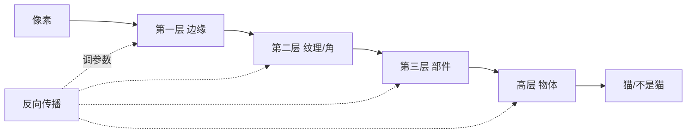

# 第 6 章：一层一层看出一只猫

> 第二部 · 学习　·　神经网络不是大脑的复制品，而是一种能把「该看什么」也学出来的模型。

- **难度**：★★★ ｜ **预估学时**：3 小时 ｜ **前置**：第 4、5 章

## 学习目标

学完本章，你能：

- 能说清一个神经元做的四件事，以及为什么必须有非线性激活。
- 能解释卷积网络的局部连接、权重共享和池化为什么适合图像。
- 能说明「表示学习」与手工特征的区别，以及反向传播在训练中的角色。

## 一句话核心

神经网络把许多简单的计算单元堆成多层，让低层学边缘、中层学部件、高层学物体；连「该看什么特征」也交给数据去决定。

## 零基础讲解

### 概念 1：一个神经元做四件事

神经网络的基本单元叫**神经元**。它做的事只有四步：

1. 接收一组输入 $x_1,\dots,x_n$。
2. 每个输入乘一个权重 $w_i$。
3. 把所有乘积求和，再加一个偏置 $b$。
4. 把结果送进一个非线性函数 $f$，得到输出。

写成一行：

$$y = f\left(\sum_i w_i x_i + b\right)$$

权重是「这个输入有多重要」，偏置是「整体门槛」。如果没有第 4 步的非线性，堆多少层都等价于一个线性变换，网络再深也学不会弯曲的关系。**激活函数**就是那个非线性开关，常见的有 ReLU：负数归零，正数照旧。

一个神经元像一个微型探测器：它只对某种模式敏感，输入够强就「放电」。单独看很笨，连成网络才厉害。

### 概念 2：层、深度与反向传播

把并排的神经元放在一起，就是**一层**；层数叫**深度**。低层看局部、简单的东西，高层把低层的结果组合成更复杂的结构。

训练时，网络先做一次**前向传播**：输入从第一层走到最后一层，得到预测。预测和真实答案算损失，然后**反向传播**把误差从最后一层往回传，用链式法则算出每个参数该往哪个方向调。一次反向传播能得到全部梯度，计算量只比前向多常数倍。没有它，深网络在算力上根本训不动。

### 概念 3：卷积网络为什么适合图像

一张图片有几百万个像素。如果每个神经元都和所有像素相连，参数会爆炸，而且图像被平移几个像素，网络就认不出来了。

**卷积神经网络（CNN）**用两个先验解决这个问题：

- **局部连接**：每个神经元只看图像的一小块区域，先找边缘、角点这些局部模式。
- **权重共享**：同一组权重在整张图上滑动，同一个「边缘探测器」扫过所有位置。猫在左上角还是右下角，用的是同一个探测器。

再配合**池化**，把相邻区域压缩成一个代表，逐层扩大视野。低层看到边缘，中层把边缘组成眼睛、耳朵，高层把部件组成猫。这个层级不是人设计的，是网络为了完成任务自己形成的。

### 概念 4：表示学习

传统机器学习需要专家手工设计特征：边缘、纹理、颜色直方图。深度学习最大的变化是**表示学习**：人只给像素和标签，网络自己发明「该看什么」。

这带来一个通用性：同一套方法可以用于图像、语音、文本、蛋白质结构。它们都变成一串数字，网络从数字里学表示。参数从几万到上万亿，但训练的道理仍然是第四章的损失加梯度下降，只是规模大了。

## 图示

这张图看两件事：前向是从像素到物体的逐层抽象；反向传播把误差从输出往回分配，调整每一层的参数。

## 类比与实例

- **类比**：认猫像拼乐高：先有最小的凸起（边缘），再把凸起拼成眼睛、耳朵（部件），最后拼成整只猫。没有人直接给「猫」的规则，只有一层层的零件。
- **实例**：手写数字识别：第一层对笔画边缘敏感，第二层把边缘组合成圈和竖线，第三层把圈和竖线组合成 0、1、8 的形状。输入一张新写的 8，网络仍然认得出，因为它学的是部件组合，不是某个具体像素位置。

## 常见误解

- 别以为 神经网络是在模仿大脑——实际上 它只是借用了「很多简单单元连接」的灵感，内部机制和人脑并不一样。
- 别以为 层数越多一定越好——实际上 太深会梯度消失、过拟合、训练困难。深度要和数据量、残差连接、归一化一起考虑。
- 别以为 网络自己会解释它看到了什么——实际上 特征层级是事后观察到的现象，网络内部没有人类可读的规则。
- 别以为 卷积只能用于图像——实际上 一维卷积可用于语音、文本、时间序列；关键是「局部模式 + 权重共享」这个先验。

## 自测题（答案）

1. 一个神经元做哪四件事？（答案：接收输入、各乘权重、求和加偏置、通过非线性激活函数输出。；解析：没有非线性，多层网络仍然只是一个线性变换。）
2. 为什么激活函数必须是非线性的？（答案：线性函数的复合仍然是线性函数，堆多少层都只能表达直线关系。；解析：非线性是网络能逼近复杂函数的前提。）
3. 卷积网络的两个关键先验是什么？（答案：局部连接和权重共享。；解析：它们大幅减少参数，并让图像平移不影响识别。）
4. 表示学习和手工特征的区别是什么？（答案：手工特征由专家设计；表示学习让网络自己从原始数据里学出该看什么。；解析：这是深度学习通用性的来源。）
5. 反向传播一次能得到什么？（答案：损失对网络中每个参数的梯度。；解析：有了全部梯度，才能用梯度下降更新参数。）

## 复习锚点

- 神经元 = 加权求和 + 偏置 + 非线性。
- CNN 靠局部连接、权重共享、池化逐层抽象。
- 表示学习把「该看什么」也交给数据。
