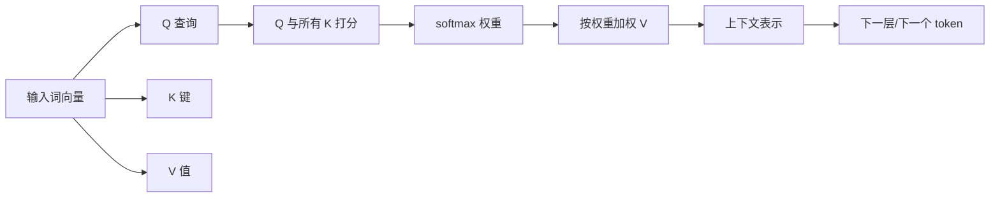

# 第 8 章：每个词都能看见其他词

> 第三部 · 语言　·　注意力机制是整门课的心脏。这一章把 Transformer 拆开，看它怎样让一个词根据上下文改变含义。

- **难度**：★★★ ｜ **预估学时**：3–4 小时 ｜ **前置**：第 6、7 章

## 学习目标

学完本章，你能：

- 能用查询、键、值的比喻解释自注意力怎样让「苹果」偏向水果或公司。
- 能说清多头注意力和位置编码各自解决什么问题。
- 能解释自回归生成、温度采样，以及模型为什么没有全局计划。

## 一句话核心

每个词发出查询、提供键和值，按相关度从所有词那里加权收集信息；一层层叠加，固定的词向量就变成了随上下文变化的表示。

## 零基础讲解

### 概念 1：一个词回头看其他词

「我早上吃了一个苹果。」和「苹果昨晚发布了新手机。」里的「苹果」是同一个 token，进入模型时是同一个向量。但它在这两句里的意思不同。模型要让它根据上下文改变。

想象一个班级，每个词是一个学生，坐成一排。轮到「苹果」发言，它做三件事：

1. 发出一个**查询（Query）**：「谁能告诉我，我是水果还是公司？」
2. 每个同学举着一张**键（Key）**，写着自己能回答什么：「吃」写着「我和食物有关」，「发布」写着「我和商业行为有关」。
3. 每个同学还准备了一份**值（Value）**，是它愿意贡献的信息。

「苹果」拿自己的查询和每张键比对，算出相关度；把所有得分用 softmax 变成加起来等于 1 的权重；再按权重把所有同学的值加权求和。因为「吃」的权重大，新向量里混入了大量食物信息，苹果的表示就偏向了水果。

每个词同时做这件事，每个位置都在看所有位置，这就是**自注意力**。一层之后，每个词吸收了上下文；再来一层，它吸收的是已经吸收过上下文的向量，关系越来越复杂。

写成公式：

$$\text{Attention}(Q,K,V)=\text{softmax}\left(\frac{QK^\top}{\sqrt{d_k}}\right)V$$

$Q,K,V$ 是词向量经过三个可训练矩阵变换得到的。除以 $\sqrt{d_k}$ 是防止分数随维度膨胀，softmax 把分数变成权重。这里没有任何「语法规则」，语法关系是模型为了预测下一个词而逼出来的副产品。

### 概念 2：多头与位置

一组查询键值不够用。一个词和其他词的关系不止一种：语法、语义、指代、位置。Transformer 用多组，每组叫一个**头**，各自学习关注不同的东西，最后把各头输出拼起来。事后观察，确实有的头专看前一个词，有的专追踪代词。

注意力本身对词序完全无感。「猫追狗」和「狗追猫」，每个词的查询、键、值都相同，结果也相同。**位置编码**在每个词向量里加入位置信息，把顺序塞回一个本身不在乎顺序的机制。

一个 Transformer 模块是：自注意力 + 残差与归一化，前馈网络 + 残差与归一化。把模块复制几十份叠起来，前面接嵌入层，后面接输出层，就是 GPT、Llama、Qwen、DeepSeek、Claude 的共同骨架。

### 概念 3：一个 token 一个 token 地写

生成是**自回归**的：把提示词切成 token 送进模型，模型输出下一个 token 的概率分布；选一个接在后面，再把新序列送进去，得到再下一个分布；重复，直到选中「结束」标记。

一段五百字的回答，意味着几百次完整的前向计算。你在界面上看到文字一个个蹦出来，不是打字动画，是它真的一个一个算。

从分布里选词有几种策略：

- **贪心**：永远选概率最大的，稳定但单调、容易重复。
- **采样**：按概率随机抽，有变化，也可能抽到低概率的怪词。
- **温度**：低温把分布压尖，接近贪心；高温把分布压平，更随机。写代码用低温，写诗用高温。
- **top-k / top-p**：只在前 k 个或累积概率达到 p 的候选里抽，限制长尾怪词。

一个重要推论：模型没有「计划」。它不会先想好整段再写，而是每一步只决定下一个 token。回答的结构感来自训练语料里大量有结构的文本。这既是它能力的来源，也是第十章幻觉的根源：它每一步选的是「最像会出现在这里的词」，不是「最真实的词」。

## 图示

这张图看注意力的数据流：同一个词向量变成 Q、K、V 三个角色，Q 和所有 K 打分，权重再用来混合所有 V。

## 类比与实例

- **类比**：像一场圆桌讨论。每个人先说出自己的问题（查询），再举牌说明自己懂什么（键），最后把自己掌握的资料（值）交出来。主持人按问题和牌的匹配程度分配发言权重，大家把听到的信息汇总成新的理解。
- **实例**：「苹果发布了新手机」：苹果的查询与「发布」「手机」的键匹配度高，与「吃」匹配度低。加权求和后，苹果的向量混入商业、产品信息，下一层就能把它当作公司。

## 常见误解

- 别以为 注意力就是模型在「关注」人——实际上 它只是数学上的加权求和，不是人类意义上的注意，也没有统一的目标。
- 别以为 Transformer 天生懂词序——实际上 自注意力本身不在乎顺序，顺序靠位置编码补进去。
- 别以为 模型先想好整段再写——实际上 它每次只预测一个 token，没有内部计划；结构感来自训练分布。
- 别以为 温度越高模型越聪明——实际上 温度只改变随机性。高温更发散，不等于更准确。

## 自测题（答案）

1. 用查询、键、值解释模型怎样知道「苹果」指公司？（答案：苹果的查询与「发布」「手机」的键匹配度高，注意力权重大，加权后向量混入商业信息，表示偏向公司。；解析：相关度由查询和键的点积算出。）
2. 注意力本身不在乎词序，模型怎么区分「猫追狗」和「狗追猫」？（答案：位置编码把每个词的位置信息加进向量，让不同位置的同一个词在进入注意力前就不同。；解析：位置编码把顺序塞回机制。）
3. 多头注意力解决什么问题？（答案：让模型同时学习多种关系类型，如语法、指代、位置，而不是用一组权重勉强表达全部。；解析：各头关注不同模式，最后拼接。）
4. 温度和贪心有什么区别？（答案：贪心每步选概率最大的 token；温度采样按调整后的概率随机抽，温度低接近贪心，温度高更随机。；解析：温度是随机性的旋钮。）
5. 为什么说模型没有「计划」？（答案：它每步只根据当前上下文预测下一个 token，不会先生成完整草稿再输出。；解析：结构感是训练语料分布的副产品。）

## 复习锚点

- 自注意力 = 查询与键打分，softmax 加权，混合值。
- 多头管关系类型，位置编码管顺序。
- 生成是一个 token 一个 token 的自回归采样。
