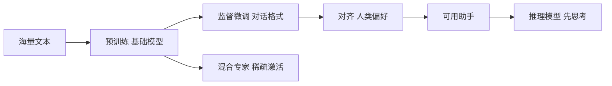

# 第 9 章：从续写机到助手

> 第三部 · 语言　·　一个只会预测下一个词的模型，怎样变成会回答问题、会拒绝、会先思考的助手？

- **难度**：★★★ ｜ **预估学时**：3 小时 ｜ **前置**：第 7、8 章

## 学习目标

学完本章，你能：

- 能说出预训练、监督微调、对齐三个阶段各自的数据、任务和产物。
- 能解释 RLHF 与 DPO 的区别，以及「对齐不是装道德模块」。
- 能说明涌现、思维链、推理模型和混合专家各自解决什么问题。

## 一句话核心

预训练教会模型语言和世界，监督微调教它对话的形式，对齐用人类偏好塑造它的取舍；三阶段之后，它仍然是一个概率分布。

## 零基础讲解

### 概念 1：三个阶段

从随机初始化的参数到一个可用助手，中间经过三段训练。

**① 预训练**：在几万亿 token 的网页、书籍、论文、代码上预测下一个 token，用几万块 GPU 跑几个月。任务看起来平淡，却逼出了语言、知识和推理能力。产物叫**基础模型**：懂世界，但只会续写。你问它「什么是光合作用」，它可能续写出「什么是呼吸作用」，因为习题集里问题后面常跟着另一个问题。

**② 监督微调（SFT）**：给它看几万到几十万条高质量的「问题 + 回答」示范，教它对话的格式与风格。它改变的主要是形式，不是知识；数据质量远比数量重要，一万条精心写的对话胜过一百万条随便写的。

**③ 对齐**：不再给标准答案，而是给人对几个回答的排序。用这些偏好训练一个奖励模型，再用强化学习让语言模型生成得分更高的回答。目标是让模型更有帮助、更诚实、更无害。

### 概念 2：RLHF 与 DPO

**RLHF（从人类反馈中强化学习）**是 ChatGPT 的关键技术。做法是：同一问题生成几个回答，请人排序；用排序训练奖励模型；再用强化学习让语言模型追求高分。

它有效，但难做：要维护单独的奖励模型，强化学习不稳定，模型还会学会「讨好」奖励模型而不是真的变好。比如写得更长、更啰嗦、更爱用「当然可以！」开头，因为标注者曾经无意中偏爱这样的回答。这叫**奖励破解**。

**DPO（直接偏好优化）**绕开奖励模型和强化学习：把「回答 A 胜过 B」直接写成一个损失函数，用普通梯度下降优化。它更简单、稳定、便宜，成为开源社区的标准做法。

需要记住：对齐不是给模型装一个道德模块，而是继续用数据塑造它的概率分布。它可以被推回去（越狱），也可能在训练数据没覆盖的角落表现异常。

### 概念 3：涌现、思维链、推理模型

模型规模跨过某个门槛后，某些能力会从「完全不会」跳到「突然会了」，比如三位数加法、多步推理、上下文学习。这叫**涌现**。它是否真是突变有争议：换一种连续评分，曲线可能只是平滑上升。但「大到某个程度后能做以前做不了的事」这个事实，是行业押注规模的理由。

模型每次只预测一个 token，没有内部草稿纸。让它把中间步骤写出来，等于把草稿纸放进上下文，每一步都能看到前面的步骤。这叫**思维链**，在数学和逻辑题上显著提高准确率。

**推理模型**把这个技巧训练成默认习惯：用强化学习奖励「先写推理过程、答案正确」，模型回答前会自发生成几百到几万 token 的思考，试错、回退、验证。代价是慢和贵。它意味着能力可以靠推理时的算力购买。

### 概念 4：混合专家

**混合专家（MoE）**把 Transformer 里的前馈网络换成几十个并列的「专家」，前面加一个路由器，每个 token 只挑其中两三个计算。总参数可以很大，每次激活的参数很小。

于是「参数量」这个数字不再直观：一个总参数六千亿、激活参数三百七十亿的 MoE 模型，运行成本可能低于一个七百亿参数的稠密模型。看参数量时，要问是总参数还是激活参数。

## 图示

这张图看训练的三段楼梯：预训练最贵、微调最短、对齐最微妙。推理模型和 MoE 是建筑完成后的两种改造。

## 类比与实例

- **类比**：像培养一个实习生：先让他读几年书（预训练），再教他怎么写邮件、怎么开会（微调），最后让同事对他的回复排序，告诉他什么该做、什么不该做（对齐）。
- **实例**：同一个问题「如何提高作文分数」，基础模型可能续写出「如何提高数学分数」；SFT 后它学会直接回答；对齐后它会拒绝代写，改为给修改建议。三个阶段改的是不同层面。

## 常见误解

- 别以为 对齐就是给模型装道德模块——实际上 它是继续训练概率分布，可以被越狱、也可能在边界外失效。
- 别以为 微调能教会模型新知识——实际上 微调主要改形式和风格，知识在预训练时已经进去；新知识更适合用检索或重新训练。
- 别以为 涌现一定是突然开窍——实际上 可能是评估指标造成的假象，也可能是真实的能力门槛；两种解释都成立一部分。
- 别以为 参数量越大运行越贵——实际上 MoE 看激活参数，总参数大不代表每次计算都用全部。

## 自测题（答案）

1. 预训练、SFT、对齐各解决什么问题？（答案：预训练学语言与世界；SFT 学对话格式；对齐按人类偏好调整取舍。；解析：三者数据分别是海量文本、示范对话、偏好排序。）
2. 基础模型为什么可能反问另一个问题？（答案：它只学过续写，训练语料里问题后面常跟着另一个问题，所以它会续写出问题而不是回答。；解析：这就是需要 SFT 的原因。）
3. RLHF 和 DPO 的主要区别是什么？（答案：RLHF 训练奖励模型再用强化学习；DPO 直接把偏好对写成损失，用梯度下降优化。；解析：DPO 更简单稳定，但目标与 RLHF 相近。）
4. 思维链为什么能提高准确率？（答案：模型没有内部草稿纸，把中间步骤写进上下文后，每一步都能看到前面的推理。；解析：推理模型把这种习惯训练成默认。）
5. MoE 的「总参数」和「激活参数」有什么区别？（答案：总参数是模型全部专家之和；激活参数是每个 token 实际用到的部分。运行成本按激活参数算。；解析：所以六千亿总参数的 MoE 可能比七百亿稠密模型更便宜。）

## 复习锚点

- 三阶段：预训练 → 监督微调 → 对齐。
- 对齐塑造概率分布，不是装道德模块。
- MoE 总参数大、激活参数小。
