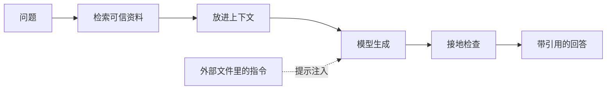

# 第 10 章：它为什么会一本正经地胡说

> 第四部 · 世界　·　幻觉不是故障，而是「预测下一个词」这种工作方式的必然产物。

- **难度**：★★☆ ｜ **预估学时**：2–3 小时 ｜ **前置**：第 8、9 章

## 学习目标

学完本章，你能：

- 能解释幻觉为什么是续写目标的自然结果，而不是偶发 bug。
- 能区分知识截止、检索增强、接地、校准四个概念。
- 能识别提示注入，并说出至少三种降低幻觉的办法。

## 一句话核心

模型优化的是「像不像会出现在这里的词」，不是「真不真」；自信的语气和内容的可靠性没有关系。

## 零基础讲解

### 概念 1：幻觉的根源

2023 年，一位律师向法庭提交了一份由聊天助手协助撰写的诉状，引用了六个判例。法官查证后发现，这六个案子一个都不存在：案名、编号、判词、法官姓名，全是模型编的，而且编得像模像样。

从前面几章看，这件事不奇怪。模型每步选的是「最像会出现在这里的 token」，不是「最真实的 token」。训练目标里只有「像」没有「真」。当它没有相关知识时，最像的续写往往是一个格式正确、语气自信的虚构。

幻觉在冷门话题、精确数字、引文、日期、人名、条款、剂量这些地方更多。不是模型「故意骗人」，而是它的工作方式没有事实核查这一环。

### 概念 2：知识截止与检索增强

**知识截止日期**是预训练数据收集截止的时间。此后的事模型一无所知，但它不一定知道自己不知道，可能基于旧知识编一个合理回答。

**检索增强生成（RAG）**是对症的办法：回答前先用向量相似度从可信资料库找出相关段落，放进上下文，让模型基于材料回答。续写的依据从模糊的训练印象变成眼前的文本，编造空间大减。企业级问答、「把 AI 接到自己的知识库」都是它。

RAG 不能完全消除幻觉。检索可能没找到、找到的是错的、模型可能误读材料。它只是把「凭记忆答」改成「看着材料答」，降低了犯错概率。

**接地**是更一般的要求：让模型的陈述有可追溯的依据，来自上下文、链接或工具返回结果。要求引用是最简单的接地手段。给不出依据的陈述，应当按未验证处理。

### 概念 3：校准与提示注入

**校准**衡量模型表达的把握程度和实际正确率是否一致。基础模型的校准通常不错：它说「很可能」时，确实比较可能对。对齐之后校准常变差，因为标注者偏爱肯定的语气。于是「自信」不再对应「正确」。实用建议：把语气当噪声，把多次回答的一致性当信号。

**提示注入**是另一个问题。模型读取的外部内容——网页、邮件、文件、工具描述——里可能藏着给模型的指令。模型无法可靠区分「用户的指令」和「文件里的话」。聊天时代最坏结果是错误文字；智能体时代可能是泄露数据或执行危险操作。

目前没有完美解法。工程上靠限制权限、隔离外部内容、关键操作人工确认。对普通用户，至少要知道：你让 AI 读的那个文件，本身可能带着指挥它的句子。

## 图示

这张图看 RAG 的主路：先检索、再放进上下文、生成后做接地检查。虚线是提示注入，它从外部内容直接影响模型。

## 类比与实例

- **类比**：闭卷考试靠记忆，容易编；开卷考试可以翻书，但书可能翻错页、看错行。RAG 是把闭卷改成开卷，不是把错误消灭。
- **实例**：问「某公司 2025 年营收多少」：模型凭记忆答了一个精确到小数点的数字，但知识截止在 2024 年；改用 RAG 检索公司年报，回答里带上页码和链接，可信度立刻不同。

## 常见误解

- 别以为 幻觉是模型出故障了——实际上 它是续写目标的自然产物，只能压低，不能彻底消灭。
- 别以为 模型语气自信就说明它对——实际上 对齐后自信和正确常脱节，必须查关键事实。
- 别以为 接了知识库就不会幻觉——实际上 检索会漏、会错、会被误读；RAG 降低概率，不提供保证。
- 别以为 文件内容一定安全——实际上 外部文件可能藏提示注入，让模型执行不属于用户的指令。

## 自测题（答案）

1. 幻觉为什么是「必然产物」而不是偶发 bug？（答案：训练目标只奖励「像会出现的词」，没有事实核查环节；缺少知识时，最像的续写就是合理虚构。；解析：它优化的是像不像，不是真不真。）
2. RAG 的基本步骤是什么？（答案：把问题变成向量，从资料库检索相关段落，放进上下文，让模型基于材料回答。；解析：它把闭卷变成开卷，但不能完全消除幻觉。）
3. 什么是接地？（答案：让陈述有可追溯的依据，比如上下文、链接或工具返回结果。；解析：要求引用是最简单的接地手段。）
4. 校准变差会带来什么实际问题？（答案：模型的自信程度不再对应正确率，用户容易把语气当成可靠性。；解析：对齐后的模型尤其明显。）
5. 提示注入是什么？（答案：外部内容里藏着给模型的指令，模型可能把它当成用户指令执行。；解析：智能体时代可能造成数据泄露或危险操作。）

## 复习锚点

- 幻觉源于「像」而不是「真」。
- RAG 把闭卷变开卷，但不保证正确。
- 自信不等于正确，关键事实必须查。
