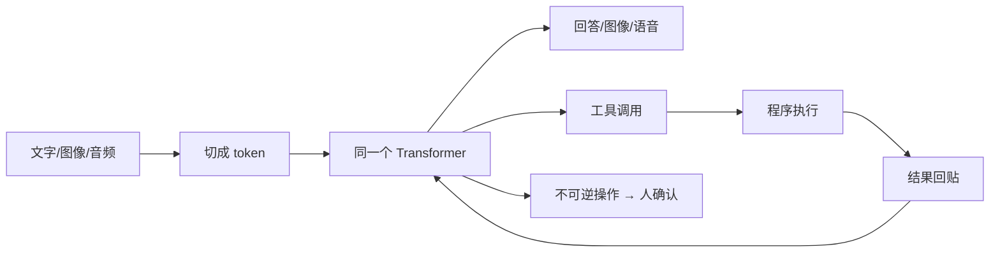

# 第 11 章：模型长出了眼睛和手

> 第四部 · 世界　·　模型开始看图、听声、画画、说话，也开始自己调用工具、执行多步任务。

- **难度**：★★★ ｜ **预估学时**：3 小时 ｜ **前置**：第 8–10 章

## 学习目标

学完本章，你能：

- 能解释多模态模型「一切都是 token」的基本做法。
- 能说清扩散模型怎样从噪声生成图像，以及语音克隆带来的身份风险。
- 能描述智能体的目标—工具—循环结构，并说出三条安全约束。

## 一句话核心

多模态把图像、音频也变成 token；工具调用把模型从「会说」变成「会做」；一旦会做，权限和验证就成了主角。

## 零基础讲解

### 概念 1：多模态：一切都是 token

前面几章的模型只处理 token 序列。但今天的助手可以看你拍的试卷照片、听你说话、根据描述画图、用自然的声音回答。这些能力没有推翻前面的原理，而是把同一种机制推向新的输入。

基本做法是**把一切变成 token**：图像切成小方块（patch），每个方块变成一个向量；音频切成时间片，每片变成向量；文字本来就是 token。它们进入同一个 Transformer，靠注意力互相对齐。**原生多模态**从预训练起就同时学多种输入，比「先转成文字描述再处理」的外挂式保留更多信息，比如图表里的空间关系、语气里的情绪。

### 概念 2：扩散模型与语音合成

**扩散模型**是今天图像和视频生成的主流。训练时给清晰图逐步加噪声，让网络学会「从更噪的图像恢复更清晰的一步」；生成时从纯噪声出发，反复应用几十次，图像从噪声中显影。文字提示通过注意力引导去噪方向。

它不是「从数据库里拼贴」，而是在噪声里一步步雕刻出一个符合提示的新图像。这也解释了为什么生成图可能细节出错：它优化的是「看起来像」，不是「物理上正确」。

**语音合成（TTS）**从文字生成语音。近年越来越多地直接用语言模型预测「声音的 token」，能带情感、停顿和口音。几秒钟的样本就足以克隆一个人的声音。这意味着声音不能再作为身份证明，接到「家人声音」的转账电话也要先核实。

### 概念 3：工具调用与智能体

**工具调用**是让模型「长出手」的关键。约定某些特殊格式的输出不是给人看的，而是触发程序去执行：搜索、计算、查数据库、操作文件。结果贴回上下文，模型继续推理。这项能力在微调和对齐阶段被训练进模型。

把模型放进一个循环，就得到**智能体**：

1. 给它目标和工具。
2. 模型思考，决定下一步。
3. 调用工具，程序执行。
4. 看结果，继续、修正或完成。
5. 不可逆的一步停下来，等人确认。

**MCP（模型上下文协议）**让工具用统一格式描述自己能做什么、需要什么参数，任何支持协议的客户端都能接入，像 USB 接口之于硬件。

智能体最先在编程领域成熟，因为代码可编译、可测试、反馈清晰自动。反馈越清晰的领域，智能体成熟得越快；反过来，反馈模糊、后果不可逆的领域，必须慢。

### 概念 4：安全带

智能体会执行有后果的行动，所以需要三道约束：

- **最小权限**：只给完成当前任务必需的权限，能读就不给写，能沙盒就不碰真实系统。
- **隔离与沙盒**：在受限的文件系统、网络和权限里执行，即使被提示注入或犯错，损害也被圈住。
- **人在回路**：可逆的自动做，不可逆的先问。部署、删除、转账、发送这类操作，必须由人批准。

这三条不是技术细节，而是「AI 不承担责任」在流程上的体现。每件由 AI 参与的事，最后要有一个人为它负责。

## 图示

这张图看两条路：一条把多模态输入变成 token 再生成；另一条把模型输出接到工具，形成行动循环。循环最后有一道人确认的闸门。

## 类比与实例

- **类比**：模型本来是一个只会说话的参谋。工具调用给它配了手和工具箱，智能体循环让它能连续干活。但手能干活也能闯祸，所以必须配权限、沙盒和审批。
- **实例**：让智能体「把网站加上深色模式并部署」：它读代码、改文件、跑测试、截图验证，这些可逆操作自动做；最后部署是不可逆的，停下来等人点确认。

## 常见误解

- 别以为 多模态就是给模型加一个图片插件——实际上 原生多模态从预训练就一起学，能把图像、文字、声音放在同一空间里对齐。
- 别以为 扩散模型是在网上搜图拼贴——实际上 它是从噪声逐步去噪生成新图，训练目标是恢复清晰图，不是检索。
- 别以为 智能体就是会聊天的模型——实际上 智能体有目标、工具、循环和权限，它会执行有后果的行动。
- 别以为 给智能体更多权限效率更高——实际上 权限越多，提示注入和误操作的损害越大。最小权限是安全带。
- 别以为 声音克隆只是娱乐——实际上 几秒样本就能复制声音，声音不能再单独作为身份凭证。

## 自测题（答案）

1. 多模态模型怎样处理一张图片？（答案：把图片切成小方块，每块变成一个向量（token），再和文字 token 一起送进 Transformer。；解析：核心是「一切都是 token」。）
2. 扩散模型生成图像的基本过程是什么？（答案：从纯噪声出发，反复应用学到的去噪步骤，在文字提示引导下逐步生成清晰图像。；解析：训练时学的是从加噪图恢复清晰图。）
3. 工具调用怎样让模型「长出手」？（答案：模型输出特殊格式的调用请求，程序执行搜索、计算、写文件等操作，结果回贴上下文继续推理。；解析：它把语言输出变成真实行动。）
4. 智能体循环的五个基本环节是什么？（答案：目标与工具、模型思考、调用工具、看结果继续/修正、不可逆操作等人确认。；解析：循环直到完成或被叫停。）
5. 智能体的三条安全约束是什么？（答案：最小权限、隔离/沙盒、人在回路。；解析：它们对应「AI 不承担责任」的流程设计。）

## 复习锚点

- 多模态 = 图像/音频也变成 token。
- 扩散模型从噪声逐步去噪生成。
- 智能体 = 模型 + 工具 + 循环 + 权限。
