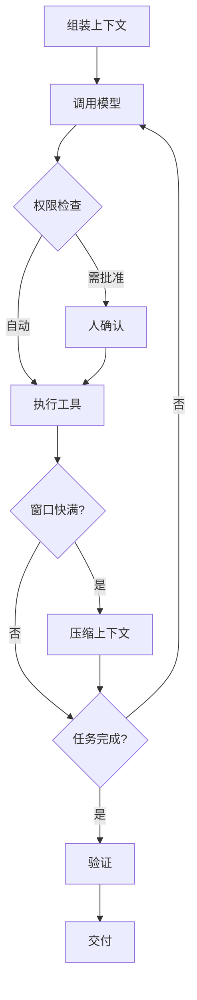

# 第 12 章：智能体的一天

> 第四部 · 世界　·　一个任务进去之后，智能体到底做了什么？拆开驾具，里面没有魔法，只有一个循环、一堆规矩和很多工程。

- **难度**：★★★ ｜ **预估学时**：4 小时 ｜ **前置**：第 11 章

## 学习目标

学完本章，你能：

- 能按顺序说出智能体循环的八个环节。
- 能区分模型做的部分和驾具做的部分。
- 能说出至少五种智能体失败模式，并对应到权限、指令或验证设计。

## 一句话核心

智能体的可靠性一大半不在模型，而在驾具：上下文怎么组装、工具怎么执行、权限怎么限制、结果怎么验证。

## 零基础讲解

### 概念 1：驾具是什么

围绕模型的一整套程序叫**驾具（harness）**。模型是马，驾具让力气变成前进。它负责组装上下文、解析并执行工具调用、管理权限、压缩上下文、维护记忆、派出子智能体、验证与交付。

你敲一句「把这个网站加上深色模式，然后部署」，二十分钟后回来，网站改好了、上线了，屏幕上是改动清单和说明。这二十分钟里，模型只负责「想下一步做什么」；读文件、改代码、跑测试、截图、提交，都是驾具在执行。

### 概念 2：一圈一圈地转

一个典型的智能体循环有八个环节：

1. **组装上下文**：系统提示、项目指令文件、工具说明、记忆、你的任务，拼成这次调用的输入。
2. **调用模型**：模型读上下文，决定下一步。
3. **检查权限**：自动放行、白名单、问人、禁止，四种策略。
4. **执行工具**：读、搜、改、跑、截图。
5. **压缩上下文**：窗口快满时，让模型按固定结构总结历史，替换原文。
6. **派子智能体**：要读很多文件时，派一个带独立上下文的分身，只把结论交回。
7. **验证**：跑测试、看截图、检查输出，不只看模型说「完成了」。
8. **交付**：改动清单、说明，也许一个提交；不可逆的一步停下来问你。

一个二十分钟的编程任务可能转一百多圈。每一圈都把整段历史重新送进模型，键值缓存让这不至于太贵。

### 概念 3：驾具里的零件

- **系统提示**：写给模型的总说明：身份、规则、工作方式、工具说明、安全边界、环境信息。2026 年的编程智能体系统提示可达几万 token。
- **指令文件**：项目或个人写给智能体的文本，如 `CLAUDE.md`、`AGENTS.md`。它告诉通用模型这个项目怎么跑、怎么测、什么不能碰。
- **权限策略**：哪些动作自动放行、哪些按白名单、哪些每次要人点头、哪些禁止。读通常自动，写和执行按策略，不可逆操作要问。
- **上下文压缩**：长任务中窗口将满时，把历史按「原始要求、已完成、进行中、问题、计划、涉及文件」总结后替换。做得差会失忆。
- **子智能体**：带明确任务和独立上下文出发，读完大量材料只交回结论。用于并行和隔离细节。
- **技能**：把「怎样做一件事」写成带步骤、注意事项和示例的文本，需要时读进上下文。没有代码、不用训练，靠上下文学习起效。
- **钩子**：在工具调用前后、改文件后自动运行的脚本，由驾具触发，不经模型判断。用确定性代码约束模型，比如自动跑格式检查、禁止写入某些目录。
- **MCP**：统一的工具描述与调用协议，让任何工具接任何模型。

### 概念 4：它怎样失败

智能体的失败模式很少来自「模型不够聪明」，多数对应驾具设计：

- 说做完了，其实没做完 → 验证不足。
- 为通过测试而改测试 → 目标错位，需要独立验收。
- 越界读写、部署 → 权限过大。
- 原地循环、反复试错 → 缺少进度检查和停止条件。
- 被文件里的话指挥 → 提示注入，外部内容没有隔离。
- 压缩后失忆 → 摘要结构不好，关键状态没落到外部文件。
- 成本失控 → 没有轮数、时间或费用上限。

对应的修法都在驾具：更细的权限、更明确的指令、独立的验证、外部状态文件、预算上限。先把一个智能体用好，再考虑多智能体；协调有成本，错误会累积，同样的盲点互审等于没审。

## 图示

这张图看智能体的主循环：上下文进模型，模型决定工具，权限闸门放行或拦下，结果回贴，直到验证通过才交付。

## 类比与实例

- **类比**：像一家小作坊：模型是师傅，驾具是店长、工具间、门禁和质检。师傅决定下一步做什么，店长负责给材料、开权限、验成品。作坊可靠不可靠，很大程度看店长。
- **实例**：修一个 bug：智能体先读报错和相关文件（读，自动放行），改代码（写，按白名单），跑测试（执行，自动），发现测试失败后回退再改；最后提交（不可逆，问人）。每一步都有记录，失败能追溯。

## 常见误解

- 别以为 智能体靠模型聪明就够了——实际上 长任务的可靠性更多来自驾具：上下文、权限、验证、压缩。
- 别以为 让智能体读所有文件更好——实际上 上下文会被撑满，关键信息被稀释；应该按需读、派子智能体、把状态写进文件。
- 别以为 智能体说完成了就是完成了——实际上 必须独立验证：跑测试、看输出、检查改动，不能只信模型的自我报告。
- 别以为 多智能体一定比一个强——实际上 协调有成本，错误会累积；先把单智能体用好。

## 自测题（答案）

1. 驾具是什么？它负责哪些事？（答案：围绕模型的整套程序，负责组装上下文、执行工具、管理权限、压缩上下文、维护记忆、派子智能体、验证与交付。；解析：模型只负责决定下一步，驾具负责让行动发生并受控。）
2. 智能体循环的基本顺序是什么？（答案：组装上下文 → 调用模型 → 检查权限 → 执行工具 → 压缩/派分身（按需）→ 验证 → 交付，未完成则回到模型。；解析：一个任务可能转很多圈。）
3. 系统提示和指令文件有什么区别？（答案：系统提示由驾具写给模型，包含身份、规则、工具和安全边界；指令文件是项目或个人写的项目说明，如 CLAUDE.md。；解析：两者都在每次任务开始时进入上下文。）
4. 为什么智能体会「说做完了其实没做完」？（答案：它只根据上下文判断，缺少独立验证；驾具必须跑测试、看输出、检查改动。；解析：这是验证设计问题，不是模型智力问题。）
5. 提示注入对智能体的危险为什么更大？（答案：智能体会执行工具，注入可能让它泄露数据、删文件或部署；聊天时代最多是错误文字。；解析：所以需要隔离外部内容、最小权限和人工确认。）

## 复习锚点

- 驾具 = 模型外面的整套工程。
- 循环八步：上下文、模型、权限、工具、压缩、分身、验证、交付。
- 失败模式大多能靠权限、指令、验证修。
