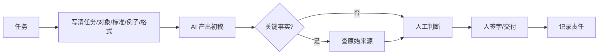

# 第 14 章：与 AI 共事

> 第四部 · 世界　·　前十三章讲它是什么。最后一章讲你该怎么办：怎样提问，怎样分工，怎样验证，怎样保护自己和别人。

- **难度**：★★☆ ｜ **预估学时**：2–3 小时 ｜ **前置**：全书

## 学习目标

学完本章，你能：

- 能写出包含任务、对象、标准、例子和输出格式的提示词。
- 能判断哪些工作交给 AI、哪些必须自己保留，并建立验证习惯。
- 能说出数据最小化、人在回路和 AI 素养在真实场景里的做法。

## 一句话核心

AI 产出很便宜，判断很稀缺；把任务、标准、例子说清，把关键事实查清，把最终责任留给人。

## 零基础讲解

### 概念 1：提示词是在塑造分布

你给模型的全部文字，就是它的上下文，决定了续写的方向。**提示词**不是咒语，而是在用文字塑造一个概率分布的形状。

一条好提示通常包含五件事：

1. **任务**：要它做什么，用动词说清。
2. **对象**：给谁看、基于什么材料。
3. **标准**：什么算好，长度、语气、必须包含/不能包含什么。
4. **例子**：给一两个输入输出示例，比形容词有效。
5. **输出格式**：列表、表格、JSON、多少字。

复杂任务让它先想再做：「先列出解题步骤，再给答案。」这不是玄学，是第八章讲的思维链：把草稿纸放进上下文。

### 概念 2：怎样分工

AI 擅长有大量先例、结果可检查、错了可改的任务：初稿、翻译、润色、总结、提取、分类、代码补全、格式转换。

它不擅长，也不该独自承担：

- **决定目标和标准**：做什么、什么算成功，是人的价值判断。
- **核对关键事实**：数字、日期、引文、人名、条款、剂量，必须查原始来源。
- **对一个具体的人的判断**：这个孩子为什么不想上学，这位病人该怎么安抚。
- **承担后果的决定**：签字、宣判、开除、转账、部署。

一个实用的分工是「它的广度 + 你的深度」：让它快速铺开候选、找资料、写初稿；你负责选方向、挖细节、做判断、担责任。

### 概念 3：验证习惯

与模型共事有三个习惯：

- **关键事实必查**：不查不用在最终产出里。
- **不懂的领域不用它做最终判断**：它可以帮你入门，不能替专家签字。
- **要求它给出依据**：来源、链接、页码、推理步骤；给不出就按未验证处理。

这不是不信任，而是由它的工作方式推出的必然。它优化「像」，不优化「真」；它的自信和正确没有稳定关系。

### 概念 4：保护自己与别人

**数据最小化**：交给 AI 服务前，只提供任务需要的部分，能匿名先匿名。条款不明的服务，不交学生作业、病历、内部文件。给智能体权限也一样：只给必需的，因为每项权限都是提示注入可利用的通道。

**人在回路**：AI 的输出被采纳、行动被执行之前，由人审核或批准。聊天时代是核对输出，智能体时代是批准行动。

**AI 素养**不是「学提示词」或「学编程」，而是三种在 AI 之前就重要、现在更显眼的能力：提出好问题、判断产出的好坏与真假、愿意并能够为 AI 参与的事负责。

如果你是教师，课堂里最该教的不是工具操作，而是边界：哪些作业可以用 AI，哪些必须自己思考；怎样要求引用；怎样识别「像而不对」。你不需要成为 AI 专家，但你需要成为判断的专家。

## 图示

这张图看人机分工：AI 负责铺开和起草，人负责定标准、查事实、做判断、签字。责任永远落在最后那个人。

## 类比与实例

- **类比**：像带一个能力很强但不知道边界的实习生。你可以让他查资料、写初稿、做表格，但对外发送前你要核对，签字的是你。
- **实例**：写一份家长通知：让 AI 根据校历和政策起草三个版本，你选定语气；核对日期、政策条款、姓名；最后签上学校和自己的名字。AI 省了起草时间，没有替你承担责任。

## 常见误解

- 别以为 提示词越长越好——实际上 关键是任务、标准、例子和格式清楚；堆形容词和重复要求只会稀释重点。
- 别以为 AI 说对了就可以直接用——实际上 关键事实、引用、数字必须查原始来源；语气自信不等于正确。
- 别以为 用 AI 就是不负责任——实际上 责任由谁签字、谁批准决定。合理使用 + 人在回路，责任仍在人。
- 别以为  AI 素养就是会用工具——实际上 工具会换代，提出好问题、判断真假、承担责任的能力更耐久。

## 自测题（答案）

1. 一条好提示通常包含哪五件事？（答案：任务、对象、标准、例子、输出格式。；解析：它是在用文字塑造概率分布，不是背模板。）
2. 哪些工作应该留给人？（答案：决定目标和标准、核对关键事实、对具体人的判断、承担后果的决定。；解析：AI 可以辅助，但不能替人负责。）
3. 三个验证习惯是什么？（答案：关键事实必查、不懂的领域不用它做最终判断、要求它给出依据。；解析：它们由模型的工作方式推出。）
4. 数据最小化具体怎么做？（答案：只提供任务必需的信息，能匿名先匿名，条款不明的服务不交敏感资料，智能体只给必需权限。；解析：每项数据和权限都是潜在风险。）
5. AI 素养的三项能力是什么？（答案：提出好问题、判断产出的好坏与真假、愿意并能够为 AI 参与的事负责。；解析：当产出成本趋近于零，判断最稀缺。）

## 复习锚点

- 提示词五件事：任务、对象、标准、例子、格式。
- AI 铺广度，人负责深度、判断和责任。
- 关键事实必查，最终签字的是人。
