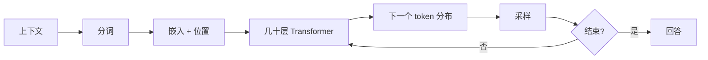

# 专题 1：一句话的旅程

> 第五部 · 拓展专题　·　从你按下发送，到屏幕上出现第一个字，中间发生了什么？

- **难度**：★★☆ ｜ **预估学时**：1–2 小时 ｜ **前置**：第 7–9 章

## 学习目标

学完本章，你能：

- 能按顺序说出一次回答的六个阶段。
- 能解释为什么第一个字最慢、后面越来越快。
- 能指出每个阶段最可能出错的地方。

## 一句话核心

一次回答是一条流水线：组装上下文、分词、嵌入、几十层注意力、概率分布、采样；每个阶段都有自己的时间尺度和错误方式。

## 零基础讲解

### 一次回答的六个阶段

1. **你的话**：提示词、系统提示、历史对话、检索材料，拼成上下文。
2. **分词**：文本切成 token。中文往往比英文占更多 token。
3. **嵌入**：每个 token 查表变成向量，再加上位置信息。
4. **几十层**：每层做自注意力（词与词交换信息）和前馈网络（每个词单独消化）。这是计算量最大的部分。
5. **概率**：最后一个位置的向量变成词表上的分布，每个 token 一个分数。
6. **选**：按贪心、温度、top-p 等策略选一个 token，接回序列，再重复。

你看到的第一个字最慢，因为要先把整段提示读一遍、算完所有层；后面的字可以复用已经算过的键和值（KV 缓存），所以快很多。一段长回答不是一次性生成，而是几百次前向计算。

### 三个尺度

- **毫秒级**：分词、嵌入、采样。你感觉不到。
- **几十毫秒每个 token**：几十层注意力与前馈。这是主要成本。
- **几秒到几十秒**：整个回答，取决于长度、模型大小、是否联网、是否先思考。

### 它没有的三样东西

- **没有长期记忆**：对话结束，上下文就没了；跨会话记住你，要靠外部存储。
- **没有事实核查**：它只保证「像」，不保证「真」。
- **没有计划**：它每步只决定下一个 token，结构的连贯性是训练分布的副产品。

理解这条流水线，你就能定位问题：答错事实，多半在知识与检索；答非所问，多半在上下文与提示；数不清字母，多半在分词；前后矛盾，多半是自回归逐步生成没有全局校验。

### 三个时间尺度

- **毫秒级**：分词、查嵌入、采样。相对便宜，但 token 多时也会累积。
- **几十毫秒每 token**：几十层 Transformer 的前向。模型越大、层越多、上下文越长，这一项越重。
- **几秒到几十秒**：完整回答。五百字大约几百个 token，就是几百次前向。

这三个尺度能解释为什么「回答短一点」有时比「换更快的模型」更有效：输出长度直接乘在第二项上。

### KV 缓存与批处理

自回归生成时，前面 token 的键和值不会变。缓存它们，下一步只算新 token 的注意力，不必重算整段。这就是 KV 缓存，也是「首 token 慢、后面快」的原因。

服务端还会把多个用户的请求拼成一批，同时算，提高 GPU 利用率。批处理让单位成本下降，但会增加排队延迟。你感受到的「慢」，有时不是模型算得慢，而是排在别人后面。

### 为什么长上下文更贵

注意力要比较每个 token 和所有 token，计算量随长度平方增长；KV 缓存也随长度线性占显存。上下文从 4k 增到 128k，不只是「多读一点」，而是注意力和显存都大幅上升。

这也解释了为什么「把整本书贴进提示」不总是好办法：贵、慢，而且中间部分容易被忽略。检索先筛出相关段落，通常比全文硬塞更有效。

## 图示

这张图看流水线的循环：每选出一个 token，就把它接回序列，再算下一个分布，直到结束标记。

## 类比与实例

- **类比**：像一条装配线：原料（文字）先被切成标准零件（token），再装上位置标签（嵌入），经过几十道工序（层），最后质检选出下一个零件。每道工序都可能出次品。
- **实例**：问「用一句话解释什么是注意力」：分词后十几个 token，每层计算每个 token 和其他 token 的关系；第一个 token 要等全部提示算完，后面每个 token 只需算新增部分，所以输出越来越快。

## 常见误解

- 别以为 模型是一次性写好整段回答——实际上 它一次只生成一个 token，反复循环。
- 别以为 第一个字和最后一个字一样快——实际上 第一个字要处理完整提示，后面有 KV 缓存，通常更快。
- 别以为 回答慢一定是网络问题——实际上 也可能是模型更大、思考更长、上下文更长或服务排队。

## 自测题（答案）

1. 一次回答的六个阶段是什么？（答案：组装上下文、分词、嵌入、几十层 Transformer、概率分布、采样。；解析：采样出的 token 接回序列，循环直到结束。）
2. 为什么第一个字最慢？（答案：要先处理完整提示、算完所有层；后续 token 可复用键值缓存。；解析：长回答是几百次前向计算。）
3. 哪个阶段最可能导致「数不清字母」？（答案：分词。模型看到的是 token 编号，不是单个字母。；解析：分词粒度决定了拼写类任务的弱点。）
4. 模型有长期记忆吗？（答案：没有。上下文窗口只在一次调用内有效，跨会话记忆需要外部存储。；解析：不要把窗口当记忆。）
5. 为什么长回答的成本随字数上升？（答案：每生成一个 token 都要跑一次前向计算，长回答就是几百次前向；上下文越长，每次计算也越重。；解析：输出不是一次性写完，而是逐 token 累积。）

## 复习锚点

- 回答流水线：上下文→分词→嵌入→层→分布→采样。
- 首 token 最慢，后续靠 KV 缓存。
- 不同错误对应不同阶段。
