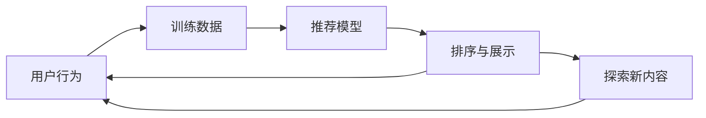

# 专题 2：推荐系统：你为什么停不下来

> 第五部 · 拓展专题　·　它预测的不是「你喜欢什么」，而是「你下一步最可能点什么」。

- **难度**：★★☆ ｜ **预估学时**：1–2 小时 ｜ **前置**：第 4、5 章

## 学习目标

学完本章，你能：

- 能解释推荐系统怎样把用户和内容变成向量并匹配。
- 能说清反馈循环为什么会让内容越来越窄。
- 能区分「提升点击」与「提升长期满意度」。

## 一句话核心

推荐系统优化的是可测量的互动指标，不是你的长期幸福；指标选错，系统就会学会让你停不下来。

## 零基础讲解

### 它在预测什么

推荐系统做的核心预测是：给定你和一个候选内容，估计你会不会点、会不会看完、会不会赞。它把用户和内容都变成向量，在同一空间里算相似度，再按分数排序。

常见信号有三类：

- **显式反馈**：评分、点赞、收藏、不感兴趣。
- **隐式反馈**：点击、停留、完播、跳过、搜索。
- **上下文**：时间、地点、设备、当前会话。

点击是最容易收集的信号，但不等于满意。你点开一个标题党，可能三秒就退出；系统却记了一次点击。

### 反馈循环

推荐系统不是被动预测，它会**改变**你看到什么，从而改变你的行为，再改变训练数据。这叫反馈循环。

如果系统只优化点击，它会不断放大标题党、极端内容、短刺激；用户越点，系统越推；系统越推，用户越点。内容越来越窄，兴趣被锁在一个小圈子里，这叫**信息茧房**或**过滤气泡**。

更难的是**冷启动**：新用户没有历史，新内容没有互动。系统必须探索：给新内容一些曝光，否则永远不知道它好不好。这就是第三章的探索与利用。

### 它在优化什么

推荐系统常用的指标：点击率、停留时长、完播率、转化率、次日留存。每个指标都是一种价值判断。

- 只优化点击 → 标题党、震惊体。
- 只优化时长 → 无限下滑、自动播放。
- 只优化转化 → 过度推销、制造焦虑。

更合理的目标要同时看短期互动和长期满意度，比如加入「不感兴趣」、举报、取消关注、长期留存，甚至直接问用户。但长期指标难测、反馈慢，工程上常被短期指标压过。

### 使用者能做什么

- 主动使用「不感兴趣」和取消关注，这是最直接的训练信号。
- 定期清理推荐源，不要让一个误点定义你接下来一个月的内容。
- 对「猜你喜欢」保持警觉：它猜的是互动概率，不是你的人格。
- 教育场景尤其要小心：用点击优化学习内容，会推给孩子更容易、更上瘾的东西，而不是更有价值的东西。

## 图示

这张图看闭环：行为变成数据，数据训练模型，模型决定展示，展示又改变行为。闭环会放大指标，也会放大偏差。

## 类比与实例

- **类比**：像一位只记住你上次点了什么的服务员。你偶尔点了一次辣，他以后每顿都给你上辣；你越吃，他越确信你爱辣。不是你变了，是他的菜单把你塑造成了这样。
- **实例**：你误点了一个游戏广告，系统记一次点击；接下来几天它反复推同类广告，你又点了一次；循环强化。直到你点「不感兴趣」，信号才被纠正。

## 常见误解

- 别以为 推荐系统懂我——实际上 它懂的是你在特定上下文里的互动概率，不是你完整的偏好。
- 别以为 点击多就是喜欢——实际上 点击可能来自标题党、误触、好奇；停留和回访才更接近满意。
- 别以为 算法是中立的——实际上 指标的选择、样本的偏差、优化目标都是价值判断。
- 别以为 信息茧房是用户自己选的——实际上 系统的排序和探索策略也在塑造你看到什么。

## 自测题（答案）

1. 推荐系统的核心预测是什么？（答案：给定用户和候选内容，估计点击、停留、完播、赞等互动概率，再排序。；解析：它优化的是可测量的互动指标。）
2. 什么是反馈循环？（答案：推荐改变用户看到的内容，用户行为又变成训练数据，继续影响下一次推荐。；解析：闭环会放大指标，也会放大偏差。）
3. 只优化点击会有什么后果？（答案：标题党、极端内容、短刺激被放大，内容变窄，长期满意度下降。；解析：点击不等于满意。）
4. 冷启动为什么要探索？（答案：新用户和新内容没有历史数据，不给曝光就永远不知道好坏。；解析：这是探索与利用的取舍。）
5. 使用者能做什么？（答案：主动使用不感兴趣、取消关注、清理推荐源，并对推荐保持警觉。；解析：你的反馈是最直接的训练信号。）

## 复习锚点

- 推荐预测互动概率，不预测长期幸福。
- 反馈循环会放大指标和偏差。
- 点击不等于满意，指标选择是价值判断。
