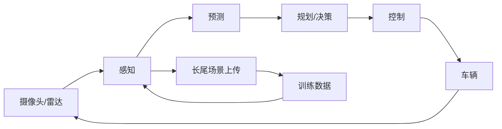

# 专题 3：自动驾驶：四种能力的合体

> 第五部 · 拓展专题　·　感知、预测、规划、控制，四种能力全用上，难在长尾。

- **难度**：★★★ ｜ **预估学时**：2–3 小时 ｜ **前置**：第 1、6、11 章

## 学习目标

学完本章，你能：

- 能拆解自动驾驶的感知、预测、规划、控制四个模块。
- 能解释模块化与端到端两条路线的取舍。
- 能说明长尾、数据闭环和分级责任为什么是核心难题。

## 一句话核心

自动驾驶不是单一模型，而是四种能力叠在一起；真正难的不是常见路况，是见不到几次的长尾和不可逆的后果。

## 零基础讲解

### 四个模块

- **感知/识别**：摄像头、激光雷达、毫米波雷达看到什么。检测车辆、行人、车道线、交通灯，估计距离和速度。
- **预测**：其他车辆和行人下一步可能怎么动。这是典型的序列预测，要考虑意图、路况、历史轨迹。
- **规划/决策**：自车走哪条路线、什么时候变道、让还是不让。它要在安全、舒适、效率之间取舍。
- **控制**：把规划变成油门、刹车、方向盘的具体指令，还要处理执行延迟和车辆动力学。

四种能力全用上，而且必须实时闭环。感知错一点，预测就偏；预测错，规划就危险；控制慢，前面全白算。

### 两条路线

**模块化**：四个模块分别做，接口清晰，每一段可解释、可测试。缺点是误差会累积，上游错了下游很难补救。

**端到端**：传感器输入直接到控制输出，一个网络学完整驾驶策略。优点是信息不丢失、整体优化；缺点是黑箱、难验证、需要大量驾驶数据。

2023 年之后端到端成为主流方向，但量产系统通常是混合：端到端做主要策略，规则和冗余做安全兜底。

### 难在长尾

常见路况容易，罕见场景难：一个穿玩偶服的人、一块掉落的床垫、一辆逆行的电动车、暴雨里被遮住的交通灯。这些场景在训练数据里出现得极少，却可能致命。这叫**长尾**。

应对靠**数据闭环**：车队遇到罕见场景，自动上传，标注，加入训练，再部署回车队。部署不是终点，而是下一轮数据的起点。谁的车队多、闭环快，谁的长尾覆盖就更好。

### 分级与责任

自动驾驶分 L0–L5：L2 是辅助驾驶，人必须监控；L3 是有条件自动驾驶，系统在限定场景负责，但接管请求时要人接手；L4 是在限定区域无人驾驶；L5 是任何地方。

分级不只是技术能力，更是**责任分配**。L2 出事故，司机负责；L4 在限定区域出事故，运营方负责。这个边界必须让用户一眼看懂，否则「辅助驾驶」会被当成「自动驾驶」。

### 怎样衡量

不能只看「平均接管次数」。要分开看：安全性（碰撞率）、舒适性（急刹、顿挫）、可用性（接管频率）、可解释性（为什么这样决策）。一个在晴天表现很好的系统，可能在雨夜完全失效；平均值会掩盖长尾。

## 图示

这张图看两个闭环：一个是毫秒级的感知—控制闭环，一个是月级的数据闭环。前者保证当下安全，后者扩展长尾覆盖。

## 类比与实例

- **类比**：像一位司机开车：眼睛看路（感知），猜前车会不会变道（预测），决定让不让（规划），手脚操作（控制）。区别是 AI 司机没有常识，也没法用「我感觉不对」兜底。
- **实例**：雨天夜路，交通灯被树枝遮住：摄像头置信度低，激光雷达看不清颜色，毫米波雷达只能测距。系统必须降级：减速、结合地图和路口几何推断、必要时提醒人接管。

## 常见误解

- 别以为 自动驾驶就是一个大模型——实际上 它是感知、预测、规划、控制的组合，还要实时和安全冗余。
- 别以为 端到端一定比模块化好——实际上 端到端整体优化但难验证；量产常用混合架构，规则做兜底。
- 别以为 平均接管次数少就安全——实际上 平均值会掩盖长尾；要看罕见场景、雨夜、逆光等分组表现。
- 别以为 L3 可以完全放手——实际上 L3 是有条件自动驾驶，系统请求接管时人必须接手，责任边界要清楚。

## 自测题（答案）

1. 自动驾驶的四个模块是什么？（答案：感知/识别、预测、规划/决策、控制。；解析：四者实时闭环，误差会累积。）
2. 模块化和端到端各有什么取舍？（答案：模块化可解释、可测试但误差累积；端到端整体优化但黑箱、难验证。；解析：量产常用混合架构。）
3. 什么是长尾？（答案：训练数据里极少出现、却可能致命的罕见场景，如玩偶服行人、掉落床垫、雨夜遮灯。；解析：长尾是自动驾驶最难的部分。）
4. 数据闭环怎样工作？（答案：车队遇到罕见场景上传，标注后加入训练，再部署回车队，形成循环。；解析：部署是下一轮数据的起点。）
5. 自动驾驶分级为什么也是责任分配？（答案：不同级别下，司机、系统、运营方承担的责任不同；边界不清会误导用户。；解析：L2 司机监控，L4 运营方在限定区域负责。）

## 复习锚点

- 自动驾驶 = 感知 + 预测 + 规划 + 控制。
- 难在长尾，靠数据闭环扩展覆盖。
- 分级不只是能力，也是责任分配。
