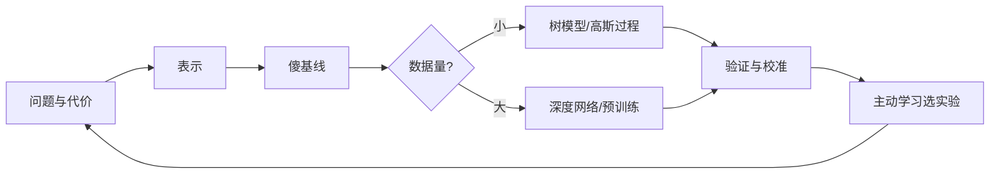

# 专题 4：给科研人的机器学习实用课

> 第五部 · 拓展专题　·　不做 AI 的科研人，怎样在自己的领域开始用机器学习，而不被它带偏。

- **难度**：★★★ ｜ **预估学时**：2–3 小时 ｜ **前置**：第 4、5 章

## 学习目标

学完本章，你能：

- 能按「问题—表示—基线—模型—验证」的顺序设计一个科研机器学习方案。
- 能判断什么时候用树模型、什么时候才上深度网络。
- 能理解高斯过程、主动学习和校准在实验科学里的价值。

## 一句话核心

先问清问题和代价，再找一个傻基线；小数据优先树模型或预训练表示，别一上来就深网络。

## 零基础讲解

### 第一步：问清问题

不要从「我要用深度学习」开始，从「我要预测什么、错了代价是什么」开始。

- 是预测一个数（回归），还是分一个类（分类），还是排一个序（排序）？
- 错报和漏报，哪个更贵？
- 如果模型给出一个预测，下一步动作是什么？做实验、筛候选、还是只做参考？

问题不清楚，模型再好也没用。一个能减少 30% 实验次数的筛选模型，比一个准确率高 1% 但无法落地的模型有价值得多。

### 第二步：表示

把样本变成数字。常见表示有三类：

- **手工描述符**：人根据领域知识设计的几十到几百个数，比如元素的电负性均值、分子的官能团计数。小数据好用、可解释。
- **指纹**：分子里有哪些子结构，变成固定长度的位串。相似性搜索的标准做法，配树模型很强。
- **学习表示**：图神经网络、预训练模型。表示从数据里学出来，需要几千到几万样本；预训练模型可以在小数据上微调或直接取向量。

表示选错，后面的模型再强也救不回来。先问：这个表示保留了决定结果的哪些信息？

### 第三步：傻基线

在训练任何复杂模型之前，先做一个傻基线：均值、线性回归、逻辑回归、一棵决策树。

基线的价值不是赢，而是给你一个「多好算好」的参照。如果深度模型只比均值好 2%，它可能没有实用价值；如果基线已经达到 90%，你可能根本不需要深度模型。

### 第四步：小数据先用树模型

科研数据常常只有几十到几千条。这个规模下，梯度提升树（XGBoost、LightGBM）和随机森林往往比深度网络更稳、更省、更容易解释。

深度网络需要更多数据、更多调参、更多算力。数据不够时，它容易过拟合，表现还不如一棵树。等数据到几万条、或者有合适的预训练模型，再考虑深网络。

### 第五步：验证与不确定性

科研使用不只关心「预测多少」，还关心「这个预测有多可靠」。**校准**让你知道模型说 80% 把握时，实际对不对。**高斯过程**和集成模型能给出不确定性，适合小数据、实验贵的场景。

**主动学习**更进一步：模型不只给预测，还告诉你「哪个候选最值得做实验」——它同时考虑「可能好」和「不知道」。这就是探索与利用在实验设计里的版本。一次实验很贵时，先做信息量最大的那个，比随机筛更省。

### 常见坑

- **标签泄漏**：特征里混进了实验结果之后的量，模型成绩虚高。
- **分布偏移**：训练数据来自旧实验条件，部署时条件是新的。
- **只报准确率**：不报置信区间、不分组、不看校准。
- **拿测试集调模型**：反复用同一份测试集选模型，测试成绩就失效了。

一个靠谱的科研机器学习项目，最后交付的不只是模型，还有：数据来源、特征定义、基线、验证方式、适用范围、失败案例。这些比多涨一个点重要。

## 图示

这张图看科研 ML 的顺序：先问题、再表示、再基线，数据量决定模型路线，最后一定要验证和校准。

## 类比与实例

- **类比**：像做实验前先写清楚假设、对照组和测量方法。模型只是其中一件仪器，不是实验设计本身。
- **实例**：材料筛选：只有 300 个已合成样本。先用手工描述符 + 梯度提升树做基线，得到 0.75 的相关系数；再用高斯过程给出不确定性，挑出「预测好且不确定」的 20 个候选做实验。比随机挑省一半实验。

## 常见误解

- 别以为 科研一定要用最深的模型——实际上 小数据下树模型常常更稳；模型复杂度要匹配数据量。
- 别以为 准确率高就说明模型有用——实际上 还要看校准、分组表现、错了的代价和能否落地。
- 别以为 预训练模型只适合大公司——实际上 开放权重模型可以在小数据上微调或直接取特征，科研团队也能用。
- 别以为 主动学习就是多标数据——实际上 它是用模型的不确定性挑最有信息量的样本，不是盲目增加标注量。

## 自测题（答案）

1. 科研机器学习的第一步是什么？（答案：问清预测什么、错了代价是什么、预测之后做什么动作。；解析：不要从模型开始，从问题开始。）
2. 为什么小数据优先树模型？（答案：树模型在几十到几千条数据上更稳、更省、更可解释；深网络容易过拟合。；解析：数据量决定模型复杂度。）
3. 校准在科研里为什么重要？（答案：它告诉使用者预测的把握是否可信，决定哪些结果值得做实验。；解析：只有预测没有不确定性，科研价值有限。）
4. 主动学习怎样选实验？（答案：优先选「可能好」且「模型不确定」的样本，用一次实验获取最多信息。；解析：它是探索与利用在实验设计里的版本。）
5. 常见的四个坑是什么？（答案：标签泄漏、分布偏移、只报准确率、拿测试集调模型。；解析：它们都会让评估结果虚高。）

## 复习锚点

- 问题 → 表示 → 基线 → 模型 → 验证。
- 小数据先用树模型，数据够了再上深网络。
- 科研使用要看校准和不确定性，不只看准确率。
