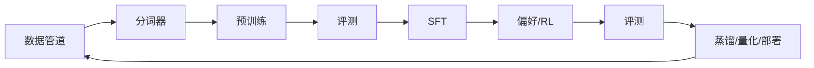

# 专题 5：训练一个模型：从数据到对齐的实操

> 第五部 · 拓展专题　·　把前面所有原理串成一条工程流水线：数据、分词、预训练、评测、微调、对齐、部署。

- **难度**：★★★ ｜ **预估学时**：3 小时 ｜ **前置**：第 4、6、8、9 章

## 学习目标

学完本章，你能：

- 能按顺序说出训练一个大模型的七个阶段。
- 能区分预训练、SFT、偏好对齐、可验证奖励 RL 各自需要的数据和算力。
- 能判断一个需求该用提示、RAG、微调还是从头训练。

## 一句话核心

训练是一条流水线，每一段都有自己的数据和评测；大多数团队真正该做的不是从头预训练，而是提示、检索或微调。

## 零基础讲解

### 流水线的七个阶段

1. **数据管道**：抓取、去重、过滤、配比。网页、书籍、论文、代码、对话按比例混合；去重能显著提升效果，因为重复会让模型「背」而不是「学」。
2. **分词器**：在语料上训练 BPE，得到词表。词表大小、语言配比会影响成本和能力。
3. **预训练**：在几万亿 token 上预测下一个 token，用几万块 GPU 跑几个月。产物是基础模型。
4. **评测**：在标准 benchmark、领域测试集、安全测试上打分，决定下一步往哪走。
5. **监督微调（SFT）**：几万条高质量示范对话，教模型对话格式与风格。
6. **偏好/强化学习**：RLHF、DPO、GRPO 等，用人类偏好或可验证奖励调整行为。
7. **蒸馏与部署**：大模型教小模型，量化压缩，部署到服务或设备。

### 三代偏好方法

- **RLHF（PPO）**：人类排序训练奖励模型，再用强化学习优化。通用助手对齐的经典方法，但需要奖励模型，训练不稳定。
- **DPO**：把偏好对直接写成损失，用梯度下降。简单稳定，开源社区常用。
- **GRPO + 可验证奖励**：数学、代码这类有标准答案的任务，直接用「答案对不对」作奖励，绕过人类偏好模型。推理模型主要靠这条路。

### 数据从哪来

预训练数据：公开网页、书籍、论文、代码、百科，清洗后几万亿 token。高质量数据正在逼近上限，所以合成数据、代码、多模态数据越来越重要。合成数据有用，但必须与真实数据混合并筛选，否则会「模型崩溃」。

SFT 数据：几万到几十万条人写或人审的对话，质量远比数量重要。

偏好数据：几十万条人类排序，或可验证的答案对。

### 评测不是最后一步

评测要贯穿全程：预训练看损失和 benchmark，SFT 看指令遵循，对齐看有帮助/诚实/无害，部署前看安全、幻觉、分布偏移。评测集要防止泄漏；用测试集反复调模型，测试就失效。

### 你该选哪一段

- **提示/技能**：改的是模型看到什么。零成本、立刻生效，永远先试。
- **检索增强（RAG）**：改的是模型回答时看到的材料。适合知识更新、企业资料。
- **微调**：改的是行为、风格、格式。需要几千到几万条示例，成本几千元级。
- **从头预训练**：改的是模型的一切。几万块 GPU、几个月、几亿元级，只有少数机构做。

一个常见错误是「知识不够就微调」。微调擅长教格式和风格，不擅长灌新知识；知识更新优先用 RAG。

### 成本量级

- 个人微调：一块 GPU 一晚，几十元电费。
- 团队 SFT：几块 GPU 一天，几千元。
- 中等预训练：几十块 GPU 几天，几万元。
- 前沿预训练：几万块 GPU 几个月，几亿到几十亿元。

理解量级，能避免「用大炮打蚊子」，也能判断供应商的报价是否离谱。

## 图示

这张图看训练主线和反馈线：评测不是最后一关，它会在预训练、SFT、对齐后反复出现，决定下一步。

## 类比与实例

- **类比**：像一条食品加工线：原料清洗（数据）、切分（分词）、长时间烹煮（预训练）、试吃（评测）、调味（SFT）、按顾客偏好调整（对齐）、包装（部署）。每道工序都有质检。
- **实例**：学校想做一个懂本校规章的助教：不需要从头训练。先用 RAG 把规章库接进去，再用几千条本校问答做 SFT 调语气；成本从几亿元降到几千元。

## 常见误解

- 别以为 想加新知识就微调——实际上 微调主要改行为和格式；新知识优先用 RAG 或重新训练。
- 别以为 预训练数据越多越好——实际上 质量、去重、配比同样重要；垃圾数据会教坏模型。
- 别以为 评测只在最后做——实际上 评测要贯穿全程，早发现问题比最后返工便宜。
- 别以为 开源模型就是完全开源——实际上 多数只开放权重，训练数据和代码不公开，准确说法是「开放权重」。

## 自测题（答案）

1. 训练大模型的七个阶段是什么？（答案：数据管道、分词器、预训练、评测、SFT、偏好/RL、蒸馏与部署。；解析：评测贯穿多个阶段，不是最后一步。）
2. 预训练、SFT、偏好对齐各需要什么数据？（答案：预训练用几万亿 token 文本；SFT 用几万条示范对话；偏好对齐用人类排序或可验证答案。；解析：数据和算力量级依次下降。）
3. RLHF、DPO、GRPO 的主要区别是什么？（答案：RLHF 用奖励模型 + 强化学习；DPO 直接优化偏好对；GRPO 用可验证奖励，适合数学和代码。；解析：三者目标相近，工程复杂度和适用场景不同。）
4. 想给模型加本校规章，应该优先用什么？（答案：RAG，把规章库检索进上下文；必要时再用 SFT 调语气。；解析：微调不擅长灌新知识。）
5. 为什么合成数据不能单独用？（答案：一代代模型在上一代输出上训练会导致分布坍缩、罕见模式消失，必须与真实数据混合并筛选。；解析：这叫模型崩溃。）

## 复习锚点

- 训练流水线：数据→分词→预训练→评测→SFT→对齐→部署。
- 大多数团队该用提示、RAG、微调，而不是从头训练。
- 知识更新优先 RAG，行为风格才用微调。
