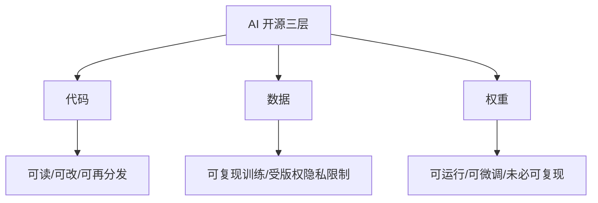

# 专题 6：AI 与开源

> 第五部 · 拓展专题　·　代码、数据、权重，三层开放程度不同；「开源模型」多数只是开放权重。

- **难度**：★★☆ ｜ **预估学时**：1–2 小时 ｜ **前置**：第 9 章

## 学习目标

学完本章，你能：

- 能区分代码开源、数据开放、权重开放三个层次。
- 能解释开放权重为什么有价值，以及它的许可证限制。
- 能判断「开源模型」这个词在具体语境里到底指什么。

## 一句话核心

AI 的开源不是一个开关，而是三层：代码、数据、权重。多数所谓开源模型只开放权重，能运行和微调，但不能复现训练。

## 零基础讲解

### 三层开放

- **代码**：训练框架、推理代码、工具链。深度学习框架从第一天就开源，这一层开放度最高。
- **数据**：公开数据集推动了每一次突破，但前沿模型的训练配方是核心机密；版权和隐私让数据最难完全开放。
- **权重**：训练完的几千亿个参数。开放权重意味着你能下载、运行、微调，但训练数据和训练代码未必公开。

一个完全开源的模型会公开训练代码、数据来源与过滤规则、训练日志和权重，任何有算力的人都能复现。这样的模型很少，因为数据配方是核心资产，公开数据来源还会带来版权风险。

绝大多数「开源模型」是**开放权重**：给你参数和推理代码，附一份许可证。许可证差别很大，从几乎无限制，到「月活超过某个数就要另谈」，再到禁止某些用途。读许可证比看「开源」标签重要。

### 开放权重的价值

最大的价值是**可微调**。在自己的数据上继续训练，得到一个懂本领域的模型，成本只是预训练的千分之一。学校可以用本校材料微调助教，医院可以用脱敏病历微调辅助系统。这是「AI 民主化」最实际的形式。

第二是**可审计**。你能在本地跑、检查行为、做安全测试，不必完全依赖供应商。第三是**可离线**。在无网或敏感环境里，开放权重模型可以本地部署。

### 蒸馏与争议

**蒸馏**让一个小模型学习大模型的输出，把能力「压」进小模型。小模型看不到大模型的参数，只看大量问题的回答或概率分布，然后模仿。蒸馏出的小模型可以在手机上跑，能力接近大模型的一部分。

争议在于：用别家闭源模型的输出来训练自己的模型，是否违反服务条款？技术上很简单，商业上是一道边界。2025 年的几起纠纷就源于此。

### 对使用者的含义

- 「开源」不等于「可复现」；要问开放的是代码、数据还是权重。
- 「免费」不等于「可商用」；许可证可能限制商业用途、用户规模、再分发。
- 开放权重模型可以本地部署，但安全、合规、维护责任也转移到你身上。
- 选择模型时，除了能力，还要看许可证、数据来源、社区支持和安全记录。

## 图示

这张图看三层开放度：代码最常开放，数据最难，权重介于两者之间。所谓「开源模型」通常只指最下面一层。

## 类比与实例

- **类比**：像一家餐厅公开了菜谱（代码）、食材采购单（数据）和半成品（权重）。只给半成品，你能加热上桌，却不知道菜谱和采购来源，也不能完全复刻。
- **实例**：某模型标称「开源」，下载后能看到权重和推理代码，但训练数据只有模糊描述，训练代码未公开。你能微调、能商用（许可证允许），但不能复现它的训练过程。准确说法是开放权重。

## 常见误解

- 别以为 开源模型 = 完全开源——实际上 多数只开放权重，训练数据和代码不公开。
- 别以为 开放权重没有价值——实际上 可微调、可审计、可离线部署，对教育和科研很有价值。
- 别以为 免费模型可以随便商用——实际上 许可证可能限制商业用途、用户规模或再分发，必须读条款。
- 别以为 蒸馏只是小模型抄大模型——实际上 它学习输出分布，能在小模型上保留部分能力，但可能涉及服务条款争议。

## 自测题（答案）

1. AI 开源的三层是什么？（答案：代码、数据、权重。；解析：三层的开放程度和限制不同。）
2. 开放权重模型能做什么、不能做什么？（答案：能下载、运行、微调、审计；不能仅凭权重复现完整训练过程。；解析：训练数据和代码未必公开。）
3. 开放权重最大的实际价值是什么？（答案：可微调，用本领域数据得到懂行的模型，成本远低于预训练。；解析：学校、医院、企业都能用。）
4. 蒸馏是什么？（答案：让小模型学习大模型的输出或概率分布，把部分能力压进小模型。；解析：技术简单，但可能涉及服务条款争议。）
5. 看到「开源模型」应该追问什么？（答案：开放的是代码、数据还是权重？许可证允许什么？能否复现？；解析：「开源」标签不能代替许可证和数据来源。）

## 复习锚点

- AI 开源三层：代码、数据、权重。
- 多数开源模型只是开放权重。
- 开放权重可微调、可审计、可离线，但要读许可证。
